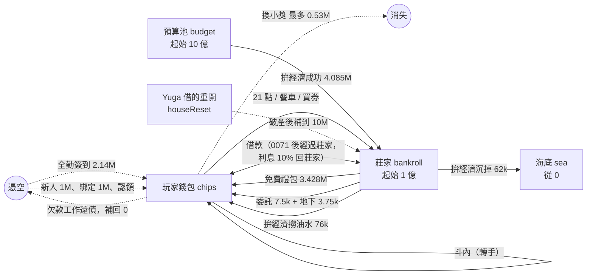
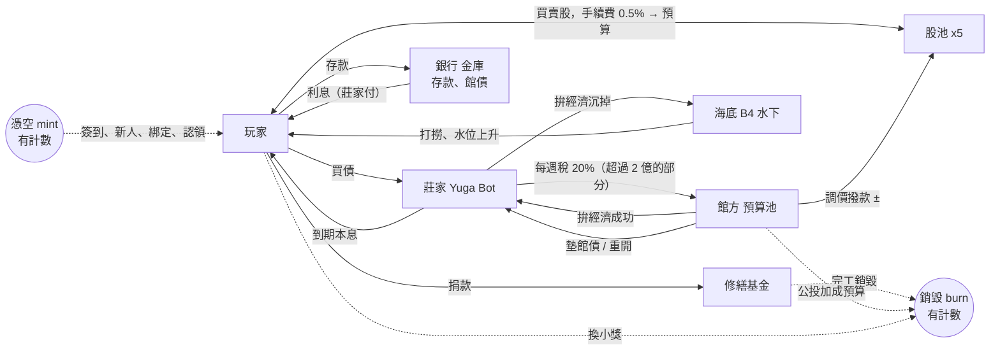

# 經濟體系規劃：錢怎麼流，以及接到世界觀的大經濟

> 2026-11-13，Claude 寫。只有規劃，沒有改遊戲程式。數字都是從程式和決定紀錄算出來的，算式寫在旁邊；算不出來的寫「看玩家」。
> 翊文 11-13 的原話：
> 「銀行的多功能，我們之後要接到整個世界觀的更大經濟體系，目前應該只有海底跟另一個預算什麼的幫我看看，看整個體系能夠規劃什麼樣的更多玩法」
> 「也可以設計債券來借莊家錢」
>
> 前提：決定 0071（借錢改從莊家出）翊文已決定，由別人實作中。本篇盤點時把它當成「現在的做法」寫。
> 每一節最後有「要翊文決定的」，沒回答的先不做。

---

## 一、現在的錢怎麼流（盤點）

### 1.1 有幾種錢

| 東西 | 在哪 | 誰能動 |
|---|---|---|
| 籌碼（玩家） | `casinoWallets/{uid}` 的 `chips`，可以是負的 | 只有 Functions |
| 莊家 `bankroll` | `casinoHouse/main`，全館共用，可以是負的（破產） | 只有 Functions |
| 預算池 `budget` | 同一份，起始 10 億（`NUM.casino.econ.budgetStart`），可以是負的、只記帳不擋（決定 0056） | 拚經濟 |
| 海底 `sea` | 同一份，從 0 開始，只進不出（決定 0057） | 拚經濟 |
| 靈感 | 存檔 `P.insp`，博物館共用 | 館內玩法 |
| 週章、大禮包券、心情、理智 | 存檔／錢包 | 看 1.5 |

預算池、海底、莊家目前玩家都看不到（決定 0056、0057 都寫「之後再討論」）。

### 1.2 籌碼從哪裡來（faucet）

「莊家出」＝錢從 `house.bankroll` 扣，總量守恆。「憑空」＝總量變多。以下都是一個「做滿每日上限」的玩家，一天大約多少。

| 線 | 算式 | 一天約 | 出自 |
|---|---|---|---|
| 每天免費大禮包 | 2 包 × 平均 1,714,000（決定 0070） | 3,428,000 | 莊家 |
| 拚經濟成功 | 3 次 ×（r 31～100 共 70/101 ＝ 69.3%）× 平均 r 65.5 × 30,000 ＝ 1,965,000 | 4,085,000 | 預算池 → 莊家 |
| 拚經濟撈油水 | 3 次 × 失敗 30.7% × 撈走 55% × 平均虧 150,000（r 0～30 平均 15 × 10,000） | 76,000 | 莊家（虧掉的那份） → 錢包 |
| 交委託 | 5 張 × 平均 1,500 | 7,500 | 莊家 |
| 地下撿籌碼 | 一天最多撿到 3 次 × 平均 1,250（每房 25%） | 最多 3,750 | 莊家 |
| 限時活動「掉進地下的找零」 | 撿到的那次另外 +800k～1.2M，機率 70%：3 次 × 約 1,000,000 | 活動日最多約 3,000,000 | 莊家 |
| 全勤簽到 | 15,000,000 ÷ 7（`NUM.signin.weekChips`） | 2,142,857（只有七天全簽的人） | **憑空** |
| 新玩家 | `startChips` 1,000,000，一次 | — | **憑空** |
| Discord 綁定 | 1,000,000，每個帳號一次 | — | **憑空** |
| 舊錢包認領 | 舊資料有多少給多少（最多 7.6 億），一次 | — | **憑空** |
| 借款本金 | 額度 1,000,000 起，準時還清再 +50%（無上限） | 看玩家 | 決定 0071 之前是憑空，之後從莊家出 |
| 工作還債（地下） | 欠款每天還 34%，三天還完，把負的錢包補回 0 | 看玩家 | **憑空**（見發現 4） |
| 莊家破產重開 `houseReset` | 破產中換日，莊家直接設成 10,000,000 | 看破產幾次 | **憑空**：補上的是（10,000,000 − 負的那個數） |
| 斗內 | 轉手，不多不少 | 0 | 錢包之間 |

### 1.3 籌碼到哪裡去（sink）

| 線 | 算式 | 去哪 |
|---|---|---|
| 21 點 | 基本打法每注約 −0.58%，亂打 −10.4%（`node test/sim_casino.cjs 100000`） | 莊家 |
| 餐車 | 價錢 1,750～2,000,000；抽券機率讓平均拿回 69～77% | 莊家（價錢）；券再從莊家領回 |
| 大禮包券 | 1 抽 2,000,000（平均 1,714,000 ＝ 86%）、11 抽 20,000,000（平均約 18,854,000 ＝ 94%） | 莊家 |
| 換小獎 | 200,000×5 ＋ 600,000×2 ＋ 1,500,000×1 ＝ 3,700,000 一週，÷7 ≈ 528,571 一天（上限） | **消失**（唯一真的銷毀籌碼的地方） |
| 借款利息 10% | 借 1,000,000 還 1,100,000 | 決定 0071 之前消失；之後回莊家 |
| 到期被直接扣 | 欠款全額，扣到負的也扣 | 決定 0071 之後先記 `w.loan.toHouse`，下一次賭場交易時交給莊家 |
| 沉海底 | 拚經濟失敗、沒被撈走：3 × 30.7% × 45% × 150,000 ≈ 62,000 | 海底，**出不來** |
| 實況主收款上限 | 一天最多收 1,000,000 | 限制，不是 sink |

### 1.4 一個玩家一天（做滿每日上限）的帳

- 從外面進錢包：3,428,000（禮包）＋ 76,000 ＋ 7,500 ＋ 約 3,750 ＋ 2,142,857（全勤）≈ **5.66M**；沒全勤約 3.5M。
- 莊家的帳：+3,947,000（拚經濟：進 4,085,000、虧 138,000）− 3,428,000 − 7,500 − 3,750 ≈ **每人每天 +0.5M**。莊家每個活躍玩家每天淨賺。
- 預算池的帳：**每人每天 −4,085,000**。
- 海底：每人每天 +62,000。

預算池從 10 億開始，多久見底：

| 活躍玩家 | 算式 | 約幾天 |
|---|---|---|
| 3 人 | 1,000,000,000 ÷ (4,085,000 × 3) | 82 天 |
| 10 人 | 1,000,000,000 ÷ 40,850,000 | 24 天 |
| 20 人 | 1,000,000,000 ÷ 81,700,000 | 12 天 |

### 1.5 靈感和其他貨幣

靈感一天能拿多少（有上限的線）：

- 展廳參觀者：`visitorInspDay` 40。
- 小遊戲：每個一天最多 5 次（`miniPerDay`）。
- 簽到：七天一輪靈感 17，平均一天約 2.4。
- 委託：每張照 `rewardPct` 75% 打折；決定 0062 寫「模擬裡交委託是靈感最大的來源」。
- 畫廊、讀書、地下、打怪、老主顧（`lineReward` 8）：各有每日上限，加起來**看玩家**。

靈感花在哪：做佩佩 12、抱枕 8、融合 3（加爸媽稀有度加價 0～4）× 一天 3 次、解鎖 8～20（共 198）、修復台 3 和 2、館長室升級等（升級價錢這次沒逐項查）。

籌碼能不能換其他的：

| 貨幣 | 籌碼能換嗎 | 怎麼換、上限 |
|---|---|---|
| 靈感 | 能 | 200,000 籌碼 ＝ 1 靈感，一週 5 次，所以一週最多 +5 靈感（約 +0.7／天） |
| 材料 → 週章 | 能，繞一圈 | 籌碼換畫布（600,000，一週 2）、金箔（1,500,000，一週 1）；3 份材料換 1 枚週章（金箔算 2 份）。一週最多約 2.7M 籌碼 → 4 份材料 → 1 枚週章。動手前要確認 `mat:畫布` 算不算舊畫布（`shop.js` 的 `matToStamp`） |
| 心情、理智 | 能，餐車 | 一天最多心情 +10、理智 +3（`foodCap`）；連贏 3 把再心情 +10（一天 30）。連輸 3 把理智 −10（一天 30） |
| 券 | 能 | 就是大禮包券，見 1.3 |
| 週章本身 | 不能直接買 | 每週任務 5 個 ×1 ＋ 全做完 +2 ＝ 一週最多 7；賭場收藏 +1 |

週章最多 7 枚一週，籌碼繞路最多多 1 枚：影響不大，但這是「籌碼 → 稀有貨幣」唯一的路，要注意別再開第二條。

### 1.6 流向圖

數字是「每個活躍玩家每天」。虛線是憑空（mint）或消失（burn）。

### 1.7 現在的問題（盤點出來的）

1. **預算池會乾，乾了就變成印錢。** 見 1.4：10 人約 24 天。預算池沒有任何進項，也沒有擋：負的還是照付（決定 0056 第 3 條）。乾了之後，拚經濟成功每人每天 4,085,000 籌碼等於憑空生出來。
2. **海底只進不出。** 每人每天 +62,000，永遠不回來，玩家看不到。10 人 100 天約 6,200 萬，是一個沒有用處的黑洞（也是故事的好材料，見第二節）。
3. **莊家每個玩家每天淨賺 0.5M，沒有出口。** 莊家只會越來越有錢；沒有稅、沒有分紅、沒有人能用到。0070 之後破產變得很少見（要靠一把 10,000,000 的大注連贏），`houseReset` 反而可能幾乎用不到。
4. **會印錢的線有好幾條，但沒有人記帳。** 全勤簽到（一個人一週 15,000,000）、新人 1M、綁定 1M、認領、`houseReset`、**工作還債**（欠款被扣、再用工作補回 0，補的是憑空來的）。以決定 0071 之後的借錢為例：借 1,000,000 → 輸給莊家 → 逾期扣 1,100,000（先記 `toHouse`，莊家收到）→ 錢包變 −1,100,000 → 工作 3 天補回 0。結果莊家多了 1,100,000，這是印出來的，而且沒有計數。
5. **籌碼沒什麼用處。** 一個全勤玩家一天進 5.66M，唯一的銷毀口一天最多 0.53M，換靈感一天不到 1 點。籌碼多半只能拿來賭，或看榜單，所以第二節的銀行、股票、捐款都是在「給籌碼用處」。
6. **21 點高手可能是正期望。** `sim_casino.cjs` 100,000 手：基本打法 −0.58%，「高手（四張牌 17 以下一直要、衝五張）」+0.15%～+0.34%（加成越多越高）。違反決定 0070 的「不能穩賺」。但 100,000 手的雜訊約 ±0.35%，所以還不能下結論，要跑 200 萬手以上確認。最大注 10,000,000，一個人一天打很多手，+0.2% 就是穩定的錢。
7. **借款額度沒有天花板。** 準時還清額度 +50%，沒有上限；10 次之後約 5,770 萬。0071 之後這筆是莊家的錢，莊家 `bankroll` 不夠時借不借？目前規則沒有寫。
8. **帳是多張的。** 預算池、海底、莊家都在 `casinoHouse/main`，但錢包散在所有玩家的文件裡，沒有任何地方算「全部加起來是多少」。要做審計、財報都需要這個數字，現在做不出來。

---

## 二、世界觀的大經濟體系

### 2.1 世界裡有誰

這個館的恐怖是「帳對不上，而且對得很整齊」（`content/排程說明.md` 第〇節的日期與主線；帳本 `main.theme`：每個記帳的人都少算一隻）。所以經濟也可以用同一個口氣：有幾個「機構」，彼此之間有錢在流，總帳永遠差一點點。

| 機構 | 對應的東西 | 故事上的身份 |
|---|---|---|
| **館方** | 預算池 `budget` | 樓上的行政。發預算、辦公投、選館長。「石沉大海」的是它的預算 |
| **莊家／Yuga Bot** | `house.bankroll` | 賭場的荷官兼莊家，曾有 120 億，禮包大災難後破產，口頭禪「拚經濟，做就對了」 |
| **Yuga Bot 銀行** | 新的 `bank`（存款、館債、股票的帳） | 同一個 Yuga Bot 開的分行 |
| **海底** | `house.sea` | **B4 水面底下**：帳本裡會計「下樓對帳，沒有再上來，還在水下數」（帳本 W50 第肆章、`mysteries`）。沉掉的錢在他那裡 |
| **玩家** | 錢包 | 館友 |

現成的對應：

- 海底 ＝ 會計還沒算完的帳。W50（12/07 起）B4 的水面浮起會計的帳本，剛好是「海底的錢浮上來」的時間點。
- 「差壹隻」 ＝ 總帳永遠差一點。**真的帳不要差**（會破壞守恆測試），但對帳畫面可以固定印「差 1 枚，原因不明」當梗，不是 bug。
- 選館長（`nt-election`，W48 d6 11/28 投票日，同天核電公投）和公投：中立的程序可以用（領票、唱票、無效票），不寫人、黨、哪邊贏（決定 0048）。經濟上的「投票」只投**館內的事**（預算撥給哪個廳），不碰真實的政策立場。
- 弊案夾層單據（帳本 `audit`，W47 發現、W50 收線）：審計活動剛好有現成的伏筆。

### 2.2 先決條件：先把帳記清楚

做任何新玩法之前，先做一件沒有風險的小事（下面記為 **P0**）：

- 在 `casinoHouse/main` 加計數：`minted`（憑空進來的籌碼總數，按來源分：簽到、新人、綁定、認領、重開、工作）、`burned`（換小獎）。這些來源本來就各有一處程式碼，只是在旁邊加一行。
- 每天 05:00 另外存一份「全館快照」：所有錢包的總和（Functions 讀一次集合）、莊家、預算池、海底、銀行。
- 一個測試擋：任何交易前後，（錢包 ＋ 莊家 ＋ 預算 ＋ 海底 ＋ 銀行池）的變化 ＝ minted − burned。
- 這個 PR 不改任何玩法，只是讓以後的每個玩法知道自己是印錢還是搬錢。後面的玩法都需要它。

### 2.3 兩個迴路（把洞補上）

現在的洞（預算池只出不進、海底只進不出、莊家只進不出）可以用兩個迴路接起來，玩家也看得懂：

- **稅**：每週一 05:00，莊家超過一個門檻（例如 2 倍起始，2 億）的部分，繳 20% 給預算池。「莊家繳營業稅給館方」。預算池有進項，就不會乾。
- **撥款**：館方的預算用在公投（撥給某個廳）和修繕（見下面）。花出去的錢是真的 sink（銷毀），這樣整個迴路有出口，不會無限累積。
- **打撈**：海底的錢可以回到玩家手上（見玩法 5）。

這樣預算池、莊家、海底都有進有出，數字可以拿來做財報。

### 2.4 玩法

每個玩法寫：怎麼玩、錢從哪來到哪去、接哪條劇情、防刷、要動的檔、大約幾個 PR。順序是我建議的先後。

#### 玩法 1：莊家財報公告（P0 的下一步，最便宜）

- **怎麼玩**：每天 05:00 在公佈欄和賭場貼一則「Yuga Bot 日報」：莊家現在多少、昨天進多少出多少、預算池剩多少、海底多深（只給水位的形容也行，如「B4 水位升高了 3 公分」）、對帳「差 1 枚」。換週時有週報。
- **錢**：不動錢，只讀。
- **劇情**：Yuga Bot 身世（`排程說明.md` 一之五）：財報本身就是它的人設，數字不對它以為是自己算錯。預算池乾的時候，財報寫「追加預算中」。
- **防刷**：沒有。注意：公開莊家的錢會讓人算「現在去賭莊家最虛弱」，所以只公告昨天的結算，不公告即時數字。
- **動哪些檔**：`shared/casino_report.js`（新，純函式）、`functions/casino.js`（每天一次寫 `casinoReport/{day}`）、公佈欄的內容來源、`shared/notices.js` 的公告、Discord 想接再接。
- **PR 數**：1～2。

#### 玩法 2：活存、定存（銀行第一階段，沿用 `docs/銀行特展老主顧招領規劃.md` 第一節）

- **怎麼玩**：存進銀行的籌碼不能直接下注。活存每天 05:00 給一點利息（初稿 0.1%，最多算 1,000 萬）；定存鎖 3 天 1%、7 天 3%，同時最多 3 筆，提早解約只拿回本金。
- **錢**：存款是搬到 `bank.vault`，總量守恆。利息從**莊家**出，莊家 `bankroll` ≤ 0 時不發（照破產處理，不印）。利息算「莊家付的借款利息」：莊家用大家的存款在做生意。每天利息上限 = 莊家 `bankroll` 的 0.05%，免得莊家被存款吸乾。
- **劇情**：Yuga Bot 銀行。破產時存款怎麼辦見玩法 3。
- **防刷**：存款不增加總量，小帳存錢也只是搬自己的錢；利息上限（每人 1,000 萬）讓分身帳號沒有意義，因為每個分身的本金也只是這個分身自己的（沒有複利魔法：分身要有錢先要有來源，而來源是每日的免費額度）。**不需要登入領利息**（自動入帳），避免「每天要回來領」的壓力。
- **動哪些檔**：`shared/casino_bank.js`（新）、`shared/config.js` 的 `NUM.casino.bank`、`functions/casino.js`、`web/src/ui_casino.js`（銀行那欄多頁籤）、`test/casino_bank.test.cjs`、模擬 `test/sim_casino.cjs` 加「每天都把錢存到最大」。
- **PR 數**：2。

#### 玩法 3：館債（玩家借錢給莊家）

這是翊文 11-13 說的「也可以設計債券來借莊家錢」。跟 0071 對稱：0071 是玩家向莊家借；館債是莊家向玩家借。

- **怎麼玩**：
  - 每週一發一期，名字跟這週劇情走（例如「B2 修繕債」）。一張面額 100,000，玩家用籌碼買，**籌碼進莊家**。
  - 週日結束時到期，莊家還面額加利息。利息按持有天數計（買得晚拿得少），不然週日才買的人白拿一週的利。
  - 利率**照莊家的健康度浮動**，莊家缺錢時利率比較高：

    | 莊家 `bankroll` | 狀態 | 這期利率（一週） | 可不可以發 |
    |---|---|---|---|
    | ≥ 起始（1 億）的一半 | 健康 | 2% | 可以，但總額上限小 |
    | 起始的 10%～一半 | 吃緊 | 5% | 可以 |
    | 0～起始的 10% | 缺錢 | 8% | 可以，額度加大 |
    | < 0 | 破產 | 不發 | 暫停，等重開 |

  - 上限：一期總額 3,000 萬、一個人最多持有 500 萬、帳號開了至少 3 天才能買。
  - 不能提早贖回、不能轉讓、不能拿去當借款擔保（先不做市場，免得被拿來洗錢）。
  - 存款利率 < 館債利率 < 借款利率：`活存 0.1%／天 (≈0.7%／週) < 定存 7 天 3% < 館債 2～8%／週 < 借款 10%／3 天`。測試要擋這個順序，避免有人借莊家的錢買館債套利。
- **錢**：買債：錢包 → 莊家。到期：莊家 → 錢包（面額 ＋ 利息）。守恆；債務記在 `house.bonds`（發行額、每人持有）。莊家用買債的錢去付 0071 的借款、免費禮包，所以「Yuga 發債，才有錢借給大家」。
- **莊家破產、到期還不出來時怎麼辦**（這是最重要的設計題）：三個選項，建議第三個。
  1. 初稿：到期只還九成（清楚、簡單，但玩家吃虧是固定的，莊家破產的機率其實很低，這個懲罰很少用到）。
  2. 展期：到期還不出就自動延一週，加碼 2%。（玩家會覺得被拖著，要寫清楚。）
  3. **按順序付**：先用莊家 `bankroll`（> 0 的部分），再用**預算池**墊（館方是最後貸款人，預算池 > 0 才能墊，墊多少記在 `house.bailout`，之後從莊家的稅收還回預算池），還是不夠才打 9 折，沒付的 10% 變成「債權憑證」，莊家 `bankroll` 回到起始的一半以上時補付。這樣把莊家破產、預算池、債券串成一條線，不會憑空印錢。
- **跟 `houseReset` 的關係**：現在破產過了換日，Yuga 直接把莊家設成 10,000,000（印錢）。建議改成：重開的錢**先從預算池拿**（館方出手），預算池也沒有時才印，印的部分記在 `minted.reset`。重開當天，債券凍結一天，不再發新的。
- **跟預算池、海底的關係**：
  - 預算池 → 莊家：拚經濟成功、墊債。莊家 → 預算池：稅。
  - 海底：不碰館債。但財報上可以寫「B4 沒有還款紀錄」之類的氛圍句。
- **劇情**：每期債券用當週劇情命名（`week.json` 的 `bond`，格式像 `casino`：名字、一句說明、利率由程式算，檢查程式擋利率欄位）。「債券的號碼」可以接 `m-count`（多一張，沒人認領）：發行一千張，持有人加起來是一千零一。這是純表面，真的帳不可以差。
- **防刷**：
  - 分身帳號：每個帳號都要有 3 天資歷，且上限是 500 萬，分身的來源只有每日免費額度；利息 2～8% 不會比分身的禮包多。
  - 買了馬上被借款套利：見利率順序測試。
  - 週日買：按持有天數計息。
  - 莊家快破產時大量買債再「債轉股」之類的：沒有這種路，債券只能等到期。
  - 一期總額上限：莊家最大負擔 3,000 萬 × 8% ＝ 240 萬一週，低於一個活躍玩家一天 0.5M 的莊家淨賺 × 人數 × 7。
- **動哪些檔**：`shared/casino_bank.js`（館債部分）、`shared/config.js`（`NUM.casino.bank.bond`）、`shared/week.js`／週內容檢查（`bond` 欄位）、`functions/casino.js`（買債、到期結算進到每次碰莊家的交易）、`web/src/ui_casino.js`、測試、模擬。
- **PR 數**：2～3（規則＋伺服器；畫面；週內容欄位）。

#### 玩法 4：館內股票（按前一天大家真的做了什麼來動）

- **怎麼玩**：五家店（餐車、Hamachi 賭場、委託櫃台、地下收藏庫、手作坊）。每天 05:00 調一次股價，依據是「昨天**不同的人**做了這家店的事」跟「過去 7 天平均」比。例如昨天來吃餐車的人比平均多，餐車漲。一天最多漲跌 10%，一個人一家最多持有 1,000 股。不能放空、不能借錢買。
- **為什麼不用單純隨機**：因為「大家真的做了什麼」才會讓人想看財報、想去玩自己持股的店。而且比較不容易被少數人操控。
- **錢（守恆的做法）**：
  - 每家店有一個**股池**。買股：籌碼進股池，發股；賣股：銷股，股池付錢。股價 ＝ 股池 ÷ 發行股數。
  - 每天調價的差額，由**預算池**撥進股池（漲）或從股池收回預算池（跌），各店互相抵銷後的淨額上限 = 預算池的 0.1%。「館方補貼賺錢的店、收回賠錢的店」。
  - 手續費 0.5%（買賣各一次）進**預算池**，當作稅，補預算池。
  - 預算池 ≤ 0 時，今天不調價（沒有錢可以撥），財報寫「停盤」。
- **期望值**：調價依據是「昨天的活動 ÷ 7 日平均」，長期平均為 0，再加上手續費 0.5%，所以整體是**略負**的小賭，符合決定 0070 的原則。加一個隨機成分（±2%）當氣氛。
- **劇情**：每天一句館內新聞（例如「昨天的烤雞肉多賣了 300 份」）寫在公佈欄；可以接週劇情：W47 數東西 → 「地下收藏庫股」因為每天的清點活動變多而漲。**不用真公司和真股市的名字、不寫真的股票代號**。
- **防刷**：
  - 只算不同的人，每人每天每店最多算 1 次，所以灌一個帳號的次數沒用；
  - 少於 5 個不同的人當天不調價（樣本太少）；
  - 持有上限 1,000 股，一天最多買賣各 5 次；
  - 想用分身灌活動？每個分身最多只能讓一家店多 1 個人，成本是要做一次那件事（吃一份餐車、打一場）；加上 ±10% 上限，賺的錢被手續費吃光。
- **動哪些檔**：`shared/casino_stock.js`（新，純函式）、伺服器每天要統計「昨天每家店有幾個不同的人用過」（現在沒有，要在 `casinoHouse` 另外加每日計數，所以要等 P0）、`web/src/ui_casino.js`、`shared/config.js`、測試。
- **PR 數**：3（統計＋股池規則；伺服器；畫面和新聞）。
- **風險**：這最像真的金融商品，要特別守界線，見第三節。**建議排在後面，等 P0 和館債上線、看過數字再做。**

#### 玩法 5：海底打撈（地下）

- **怎麼玩**：地下 B4（水面）多一種房間「水邊」：走完一間（沿用現有「走完房間擲一次」）可以多撈一次，有機會從海底撈出籌碼，不是從莊家出，是**從海底出**。海底夠多時，B4 的描述多一行水位的變化。
- **錢**：海底 → 玩家錢包。每次撈到海底的 0.02%（最少 1,000、最多 50,000），海底低於 100,000 時不撈。一人一天最多撈 3 次。
- **「浮上來」事件**：週內容可以排一場限時活動（類型像 `cellarChips`）「水位上升」：那段時間撈的機率變高，撈到的量變成 0.1%。W50 B4 的帳本浮起來時開一場，海底的錢一部分回到大家手上。
- **審計**：撈起來的東西在賭場財報裡註記「B4 的水下，有人在數」，不揭曉誰（會計）。
- **劇情**：W50「對帳」第肆章。海底 ＝ 會計還沒算完的帳。
- **防刷**：沿用地下撈的每日次數；撈的量與海底成比例，海底少就撈得少；每次都走地下才撈，所以不能掛機。分身多撈只分走同一個池子。
- **動哪些檔**：`shared/casino_find.js`（加一個「撈」，或獨立 `casino_sea.js`）、`functions/casino.js` 的地下撿籌碼那條路、地下房間的畫面、`NUM.casino.sea`、測試。
- **PR 數**：1～2。

#### 玩法 6：捐款修繕（真正的 sink）

- **怎麼玩**：館方貼出「這週要修的東西」（例如 B2 的樓梯、B3 的畫框），目標 5,000 萬籌碼。大家捐，捐款進度條全館看得到，捐滿了，**全館小加成一週**（例如委託籌碼 +10%、地下撿的機率 +5%、展廳參觀者上限 +2），沒捐滿就沒有加成，不處罰。個人可以看自己捐多少，但**不排名**。
- **錢**：玩家 → 修繕基金 → 工程完成時**銷毀**（記在 `burned.repair`）。預算池可以補一部分缺口（例如 20%，上限 1,000 萬），因為館方也要出錢。這是整個體系最乾淨的 sink，也是籌碼的用處。
- **劇情**：修繕的東西接當週劇情（B2 的白布、B3 的畫框）。修好了，下一週劇情變一點。
- **防刷**：捐款單向、不可退；一人一天最多捐 1,000 萬；加成小（總共不超過 +10%），不會變成「必須捐才玩得下去」。
- **動哪些檔**：`shared/casino_fund.js`（新）、週內容 `week.json` 的 `repair`、`functions/casino.js`、玩法 2 的畫面旁邊、加成接到各自的 `NUM`（要有一個 `bonusOf(週)`）。
- **PR 數**：2。

#### 玩法 7：預算公投（玩家投票決定預算撥給哪個廳）

- **怎麼玩**：每週六 05:00～週日 05:00 公投，三個選項（例如「委託櫃台加碼」「地下加碼」「展廳加碼」）。一人一票，**不用籌碼投票**，免得有錢的人買票。得票最多的廳，下週得到小加成。
- **錢**：預算池 → 被選中的廳的加成預算（記為 sink，`burned.referendum`，上限 1,000 萬一週）。預算池 ≤ 0 時，公投還是辦（只是沒有加成預算，當氣氛）。
- **劇情**：W48 d6（11/28）投票日剛好有選館長和核電公投：同一天用「領票、蓋章、唱票、無效票」的程序，票箱數出來永遠多一票。**加成選項只談館內的事，不碰真實的政策立場，不寫哪邊對**。
- **防刷**：一人一票（帳號開 3 天以上才能投），結果由伺服器算；多帳號票的影響有限（加成小）。
- **動哪些檔**：`shared/casino_vote.js`（新）、`functions/`（投票和結算）、週內容、公佈欄的版面。
- **PR 數**：2。

#### 玩法 8：審計／對帳活動

- **怎麼玩**：每週一次「審計日」（W47 的弊案夾層單據找到後，W50 收線）。畫面給一頁三本帳（莊家、預算池、海底）的昨日數字，其中一本有一筆被改過（伺服器從真實的記帳裡挑一筆，把原因用故事講）。玩家選出「哪一本不對」，對的人拿一個小獎（很小的籌碼加一枚紀念品），錯的看解答。
- **錢**：獎勵從預算池出，一人一週一次，上限小（例如 100,000）。這是預算池的一個小出口。
- **劇情**：帳本 `audit`（弊案夾層單據）。會計的字跡：審計單上有一行跟招領單同一個人的小字。W50 的審計日用來揭露「海底的數字比記的多 1 枚」。
- **防刷**：一人一週一次；答案由伺服器從當天的真實帳算；題目一週只有一個，沒有刷的空間。
- **動哪些檔**：`shared/casino_audit.js`（新）、週內容、`functions/`。
- **PR 數**：1～2。

#### 玩法 9：稅與手續費（機制，不是單獨玩法）

- 館債、股票買賣的手續費進預算池（補預算池）。
- 莊家門檻稅（2.3）每週一次。
- 籌碼換小獎維持唯一的銷毀口，再加捐款修繕。
- 這些都用 P0 的計數，財報看得到。

#### 玩法 10：跨館友交易、拍賣（先擱著）

- 玩家掛上自己的紀念品（賭場財產、成就稱號不行）標價拍賣，成交抽 5% 進預算池。
- 風險最大：用「買我的紀念品」可以洗錢（分身轉錢給本尊）。要有一天收款上限（像實況主的 `receiveCap`）、新帳號不能參加，而且紀念品很少，市場可能是空的。
- 建議等其他的都穩定、看到真的有人想交易再做。**先不排。**

### 2.5 全景圖（目標狀態）

---

## 三、界線（每個玩法都要守）

- **不做真錢，籌碼不能換現實的東西**（`docs/界線.md`）。籌碼換不到週章以外的稀有貨幣（1.5 已經有一條繞路，不再開第二條）。
- **不鼓勵沉迷**：
  - 利息、股價都自動算，**不需要每天回來領**；
  - 每天有上限、不顯示連續登入的獎勵、沒有推播；
  - 不做「你今天賺了多少」的大字、不做報酬率排行；
  - 股票不能放空、不能槓桿、一天一家最多漲跌 10%、持股有上限；
  - 週日或存到上限時，畫面寫「今天夠了」。
- **平均要「小賭一把」，不能穩賺**（決定 0070）：
  - 21 點、股票：期望值 ≤ 0（股票靠手續費）。
  - 存款、館債是**有上限的小額穩定利息**，是莊家付的零用，不是賭局。要翊文決定這樣算不算違反 0070（見問題 3）。
  - 21 點高手可能是正的，要先確認（發現 6）。
- 每個新玩法上線前：`test/sim_casino.cjs` 加「一個人每天把能做的做到最滿，一個月後多多少」，數字寫進日誌。測試擋三件事：總量守恆（P0 的不變式）、利率順序、每個人每天的最大收益上限。

---

## 四、建議先做哪 2～3 個

| 順序 | 做什麼 | 為什麼 |
|---|---|---|
| 1 | **P0 記帳＋玩法 1 莊家財報** | 沒有風險，不改玩法。現在最大的問題是沒人知道錢到底在哪（發現 8），而且預算池 10 人約 24 天就乾（發現 1），早點看到數字才能決定要不要加稅。也順手讓玩家看得到預算池和海底，劇情才接得上。 |
| 2 | **活存、定存 ＋ 館債（玩法 2、3，銀行前半）** | 翊文最想要的銀行功能；規則簡單、不會把經濟弄壞；館債剛好跟 0071 對稱，補上「莊家的錢從哪來」，也決定了莊家破產和 `houseReset` 怎麼處理。 |
| 3 | **海底打撈（玩法 5）**，配 W50 的劇情 | 重用現成的地下撿籌碼，PR 很小；把海底這個黑洞變成有故事的出口（會計還在水下數）；時間剛好對上 W50（12/07 起）。 |

稍後再做：捐款修繕（真正的 sink，等銀行穩定）、預算公投（可以趕上 W48 d6，但太趕，下一次選舉或公投再配）、審計。最後才做：股票、拍賣。

---

## 五、要翊文決定的問題

1. **預算池要補水嗎？** 現在 10 人約 24 天就乾，乾了拚經濟就是印錢。建議加「莊家門檻稅」（超過 2 億的部分每週繳 20%），行嗎？還是讓預算池乾，把它當劇情（「預算用完了，館方也開始借錢」）？
2. **簽到全勤每週 1,500 萬（憑空）要不要改成預算池出？** 這是最大的憑空來源（一個人一天 2.14M）。改了，預算池乾得更快；不改，總量一直變多。
3. **存款利息、館債算不算「穩賺」？** 決定 0070 說不能穩賺。存款和館債是有上限的小額穩定利息，由莊家出。可以接受，還是要加風險（例如利息不保證、莊家破產時存款也要打折）？
4. **館債到期莊家還不出來怎麼辦？** 初稿「只還九成」、展期加碼、或「先莊家再預算池墊，最後才打折」（我建議後者）。
5. **館債利率可以照莊家的健康度浮動嗎（2%／5%／8%）？** 一人上限 500 萬、一期 3,000 萬、帳號 3 天以上，這些數字行嗎？
6. **`houseReset` 的錢從預算池拿，還是繼續由 Yuga 印？** 建議先從預算池拿，不夠才印並記帳。
7. **0071 之後，莊家 `bankroll` 不夠時，借錢要不要擋？** 目前額度只看玩家自己。建議莊家 ≤ 0 時暫停借款（跟館債一起）。
8. **工作還債補的錢（憑空）可以嗎？** 它是「勞動換來的」，我建議保留，但要記在 `minted.work`。還是改成從預算池出？
9. **21 點高手可能略賺（+0.15%～+0.34%，雜訊大）**：要先用 200 萬手以上確認，確認的話要降五張牌的賠率，還是限制最大注？
10. **籌碼榜要不要把存款、債券、股票算進去（算「身家」）？** 我的建議：榜單只算錢包，身家只給自己看。
11. **股票要做嗎？** 它最像金融商品。如果要做，要不要接受：不能放空、不能槓桿、不排行、持股上限、一天最多 10%？
12. **海底的錢要什麼時候浮上來？** 我建議 W50（12/07 起）B4 帳本浮起那一週，開一場「水位上升」活動；之前玩家只看得到水位，不看得到數字。
13. **預算公投的選項可以只談「館內加成」嗎？** 不碰真實的政策、不寫哪邊對（決定 0048）。W48 d6 剛好是選舉和核電公投日：要不要趕這一天，還是之後的別週？
14. **財報要不要發 Discord？** 預設：只在遊戲內公佈欄，Discord 之後再說。
15. **拍賣、跨館友交易**：要不要排？我建議先不排。
