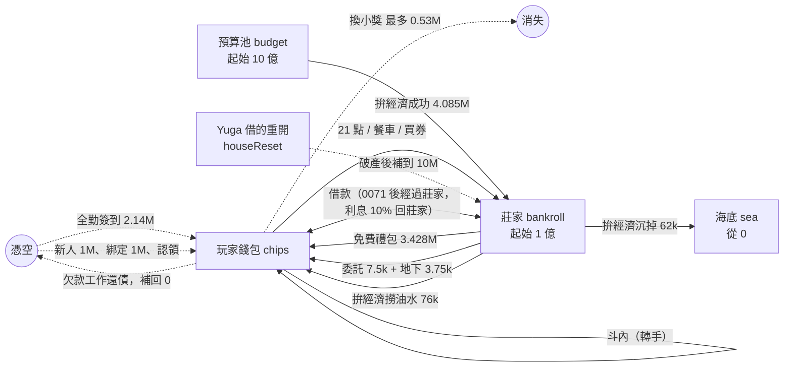
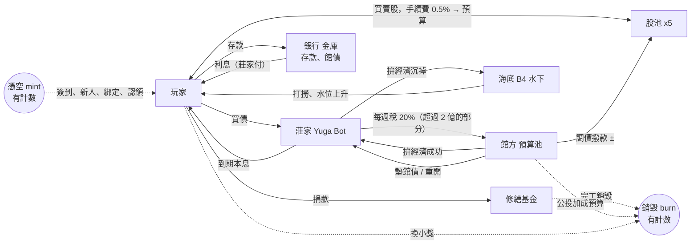

# 經濟體系規劃：錢怎麼流，以及接到世界觀的大經濟

> 2026-11-13，Claude 寫。只有規劃，沒有改遊戲程式。數字都是從程式和決定紀錄算出來的，算式寫在旁邊；算不出來的寫「看玩家」。
> 翊文 11-13 的原話：
> 「銀行的多功能，我們之後要接到整個世界觀的更大經濟體系，目前應該只有海底跟另一個預算什麼的幫我看看，看整個體系能夠規劃什麼樣的更多玩法」
> 「也可以設計債券來借莊家錢」
>
> 前提：決定 0071（借錢改從莊家出）翊文已決定，由別人實作中。本篇盤點時把它當成「現在的做法」寫。
> 每一節最後有「要翊文決定的」，沒回答的先不做。

---

## 一、現在的錢怎麼流（盤點）

### 1.1 有幾種錢

| 東西 | 在哪 | 誰能動 |
|---|---|---|
| 籌碼（玩家） | `casinoWallets/{uid}` 的 `chips`，可以是負的 | 只有 Functions |
| 莊家 `bankroll` | `casinoHouse/main`，全館共用，可以是負的（破產） | 只有 Functions |
| 預算池 `budget` | 同一份，起始 10 億（`NUM.casino.econ.budgetStart`），可以是負的、只記帳不擋（決定 0056） | 拚經濟 |
| 海底 `sea` | 同一份，從 0 開始，只進不出（決定 0057） | 拚經濟 |
| 靈感 | 存檔 `P.insp`，博物館共用 | 館內玩法 |
| 週章、大禮包券、心情、理智 | 存檔／錢包 | 看 1.5 |

預算池、海底、莊家目前玩家都看不到（決定 0056、0057 都寫「之後再討論」）。

### 1.2 籌碼從哪裡來（faucet）

「莊家出」＝錢從 `house.bankroll` 扣，總量守恆。「憑空」＝總量變多。以下都是一個「做滿每日上限」的玩家，一天大約多少。

| 線 | 算式 | 一天約 | 出自 |
|---|---|---|---|
| 每天免費大禮包 | 2 包 × 平均 1,714,000（決定 0070） | 3,428,000 | 莊家 |
| 拚經濟成功 | 3 次 ×（r 31～100 共 70/101 ＝ 69.3%）× 平均 r 65.5 × 30,000 ＝ 1,965,000 | 4,085,000 | 預算池 → 莊家 |
| 拚經濟撈油水 | 3 次 × 失敗 30.7% × 撈走 55% × 平均虧 150,000（r 0～30 平均 15 × 10,000） | 76,000 | 莊家（虧掉的那份） → 錢包 |
| 交委託 | 5 張 × 平均 1,500 | 7,500 | 莊家 |
| 地下撿籌碼 | 一天最多撿到 3 次 × 平均 1,250（每房 25%） | 最多 3,750 | 莊家 |
| 限時活動「掉進地下的找零」 | 撿到的那次另外 +800k～1.2M，機率 70%：3 次 × 約 1,000,000 | 活動日最多約 3,000,000 | 莊家 |
| 全勤簽到 | 15,000,000 ÷ 7（`NUM.signin.weekChips`） | 2,142,857（只有七天全簽的人） | **憑空** |
| 新玩家 | `startChips` 1,000,000，一次 | — | **憑空** |
| Discord 綁定 | 1,000,000，每個帳號一次 | — | **憑空** |
| 舊錢包認領 | 舊資料有多少給多少（最多 7.6 億），一次 | — | **憑空** |
| 借款本金 | 額度 1,000,000 起，準時還清再 +50%（無上限） | 看玩家 | 決定 0071 之前是憑空，之後從莊家出 |
| 工作還債（地下） | 欠款每天還 34%，三天還完，把負的錢包補回 0 | 看玩家 | **憑空**（見發現 4） |
| 莊家破產重開 `houseReset` | 破產中換日，莊家直接設成 10,000,000 | 看破產幾次 | **憑空**：補上的是（10,000,000 − 負的那個數） |
| 斗內 | 轉手，不多不少 | 0 | 錢包之間 |

### 1.3 籌碼到哪裡去（sink）

| 線 | 算式 | 去哪 |
|---|---|---|
| 21 點 | 基本打法每注約 −0.58%，亂打 −10.4%（`node test/sim_casino.cjs 100000`） | 莊家 |
| 餐車 | 價錢 1,750～2,000,000；抽券機率讓平均拿回 69～77% | 莊家（價錢）；券再從莊家領回 |
| 大禮包券 | 1 抽 2,000,000（平均 1,714,000 ＝ 86%）、11 抽 20,000,000（平均約 18,854,000 ＝ 94%） | 莊家 |
| 換小獎 | 200,000×5 ＋ 600,000×2 ＋ 1,500,000×1 ＝ 3,700,000 一週，÷7 ≈ 528,571 一天（上限） | **消失**（唯一真的銷毀籌碼的地方） |
| 借款利息 10% | 借 1,000,000 還 1,100,000 | 決定 0071 之前消失；之後回莊家 |
| 到期被直接扣 | 欠款全額，扣到負的也扣 | 決定 0071 之後先記 `w.loan.toHouse`，下一次賭場交易時交給莊家 |
| 沉海底 | 拚經濟失敗、沒被撈走：3 × 30.7% × 45% × 150,000 ≈ 62,000 | 海底，**出不來** |
| 實況主收款上限 | 一天最多收 1,000,000 | 限制，不是 sink |

### 1.4 一個玩家一天（做滿每日上限）的帳

- 從外面進錢包：3,428,000（禮包）＋ 76,000 ＋ 7,500 ＋ 約 3,750 ＋ 2,142,857（全勤）≈ **5.66M**；沒全勤約 3.5M。
- 莊家的帳：+3,947,000（拚經濟：進 4,085,000、虧 138,000）− 3,428,000 − 7,500 − 3,750 ≈ **每人每天 +0.5M**。莊家每個活躍玩家每天淨賺。
- 預算池的帳：**每人每天 −4,085,000**。
- 海底：每人每天 +62,000。

預算池從 10 億開始，多久見底：

| 活躍玩家 | 算式 | 約幾天 |
|---|---|---|
| 3 人 | 1,000,000,000 ÷ (4,085,000 × 3) | 82 天 |
| 10 人 | 1,000,000,000 ÷ 40,850,000 | 24 天 |
| 20 人 | 1,000,000,000 ÷ 81,700,000 | 12 天 |

### 1.5 靈感和其他貨幣

靈感一天能拿多少（有上限的線）：

- 展廳參觀者：`visitorInspDay` 40。
- 小遊戲：每個一天最多 5 次（`miniPerDay`）。
- 簽到：七天一輪靈感 17，平均一天約 2.4。
- 委託：每張照 `rewardPct` 75% 打折；決定 0062 寫「模擬裡交委託是靈感最大的來源」。
- 畫廊、讀書、地下、打怪、老主顧（`lineReward` 8）：各有每日上限，加起來**看玩家**。

靈感花在哪：做佩佩 12、抱枕 8、融合 3（加爸媽稀有度加價 0～4）× 一天 3 次、解鎖 8～20（共 198）、修復台 3 和 2、館長室升級等（升級價錢這次沒逐項查）。

籌碼能不能換其他的：

| 貨幣 | 籌碼能換嗎 | 怎麼換、上限 |
|---|---|---|
| 靈感 | 能 | 200,000 籌碼 ＝ 1 靈感，一週 5 次，所以一週最多 +5 靈感（約 +0.7／天） |
| 材料 → 週章 | 能，繞一圈 | 籌碼換畫布（600,000，一週 2）、金箔（1,500,000，一週 1）；3 份材料換 1 枚週章（金箔算 2 份）。一週最多約 2.7M 籌碼 → 4 份材料 → 1 枚週章。動手前要確認 `mat:畫布` 算不算舊畫布（`shop.js` 的 `matToStamp`） |
| 心情、理智 | 能，餐車 | 一天最多心情 +10、理智 +3（`foodCap`）；連贏 3 把再心情 +10（一天 30）。連輸 3 把理智 −10（一天 30） |
| 券 | 能 | 就是大禮包券，見 1.3 |
| 週章本身 | 不能直接買 | 每週任務 5 個 ×1 ＋ 全做完 +2 ＝ 一週最多 7；賭場收藏 +1 |

週章最多 7 枚一週，籌碼繞路最多多 1 枚：影響不大，但這是「籌碼 → 稀有貨幣」唯一的路，要注意別再開第二條。

### 1.6 流向圖

數字是「每個活躍玩家每天」。虛線是憑空（mint）或消失（burn）。



### 1.7 現在的問題（盤點出來的）

1. **預算池會乾，乾了就變成印錢。** 見 1.4：10 人約 24 天。預算池沒有任何進項，也沒有擋：負的還是照付（決定 0056 第 3 條）。乾了之後，拚經濟成功每人每天 4,085,000 籌碼等於憑空生出來。
2. **海底只進不出。** 每人每天 +62,000，永遠不回來，玩家看不到。10 人 100 天約 6,200 萬，是一個沒有用處的黑洞（也是故事的好材料，見第二節）。
3. **莊家每個玩家每天淨賺 0.5M，沒有出口。** 莊家只會越來越有錢；沒有稅、沒有分紅、沒有人能用到。0070 之後破產變得很少見（要靠一把 10,000,000 的大注連贏），`houseReset` 反而可能幾乎用不到。
4. **會印錢的線有好幾條，但沒有人記帳。** 全勤簽到（一個人一週 15,000,000）、新人 1M、綁定 1M、認領、`houseReset`、**工作還債**（欠款被扣、再用工作補回 0，補的是憑空來的）。以決定 0071 之後的借錢為例：借 1,000,000 → 輸給莊家 → 逾期扣 1,100,000（先記 `toHouse`，莊家收到）→ 錢包變 −1,100,000 → 工作 3 天補回 0。結果莊家多了 1,100,000，這是印出來的，而且沒有計數。
5. **籌碼沒什麼用處。** 一個全勤玩家一天進 5.66M，唯一的銷毀口一天最多 0.53M，換靈感一天不到 1 點。籌碼多半只能拿來賭，或看榜單，所以第二節的銀行、股票、捐款都是在「給籌碼用處」。
6. **21 點高手可能是正期望。** `sim_casino.cjs` 100,000 手：基本打法 −0.58%，「高手（四張牌 17 以下一直要、衝五張）」+0.15%～+0.34%（加成越多越高）。違反決定 0070 的「不能穩賺」。但 100,000 手的雜訊約 ±0.35%，所以還不能下結論，要跑 200 萬手以上確認。最大注 10,000,000，一個人一天打很多手，+0.2% 就是穩定的錢。
7. **借款額度沒有天花板。** 準時還清額度 +50%，沒有上限；10 次之後約 5,770 萬。0071 之後這筆是莊家的錢，莊家 `bankroll` 不夠時借不借？目前規則沒有寫。
8. **帳是多張的。** 預算池、海底、莊家都在 `casinoHouse/main`，但錢包散在所有玩家的文件裡，沒有任何地方算「全部加起來是多少」。要做審計、財報都需要這個數字，現在做不出來。

---

## 二、世界觀的大經濟體系

### 2.1 世界裡有誰

這個館的恐怖是「帳對不上，而且對得很整齊」（`content/排程說明.md` 第〇節的日期與主線；帳本 `main.theme`：每個記帳的人都少算一隻）。所以經濟也可以用同一個口氣：有幾個「機構」，彼此之間有錢在流，總帳永遠差一點點。

| 機構 | 對應的東西 | 故事上的身份 |
|---|---|---|
| **館方** | 預算池 `budget` | 樓上的行政。發預算、辦公投、選館長。「石沉大海」的是它的預算 |
| **莊家／Yuga Bot** | `house.bankroll` | 賭場的荷官兼莊家，曾有 120 億，禮包大災難後破產，口頭禪「拚經濟，做就對了」 |
| **Yuga Bot 銀行** | 新的 `bank`（存款、館債、股票的帳） | 同一個 Yuga Bot 開的分行 |
| **海底** | `house.sea` | **B4 水面底下**：帳本裡會計「下樓對帳，沒有再上來，還在水下數」（帳本 W50 第肆章、`mysteries`）。沉掉的錢在他那裡 |
| **玩家** | 錢包 | 館友 |

現成的對應：

- 海底 ＝ 會計還沒算完的帳。W50（12/07 起）B4 的水面浮起會計的帳本，剛好是「海底的錢浮上來」的時間點。
- 「差壹隻」 ＝ 總帳永遠差一點。**真的帳不要差**（會破壞守恆測試），但對帳畫面可以固定印「差 1 枚，原因不明」當梗，不是 bug。
- 選館長（`nt-election`，W48 d6 11/28 投票日，同天核電公投）和公投：中立的程序可以用（領票、唱票、無效票），不寫人、黨、哪邊贏（決定 0048）。經濟上的「投票」只投**館內的事**（預算撥給哪個廳），不碰真實的政策立場。
- 弊案夾層單據（帳本 `audit`，W47 發現、W50 收線）：審計活動剛好有現成的伏筆。

### 2.2 先決條件：先把帳記清楚

做任何新玩法之前，先做一件沒有風險的小事（下面記為 **P0**）：

- 在 `casinoHouse/main` 加計數：`minted`（憑空進來的籌碼總數，按來源分：簽到、新人、綁定、認領、重開、工作）、`burned`（換小獎）。這些來源本來就各有一處程式碼，只是在旁邊加一行。
- 每天 05:00 另外存一份「全館快照」：所有錢包的總和（Functions 讀一次集合）、莊家、預算池、海底、銀行。
- 一個測試擋：任何交易前後，（錢包 ＋ 莊家 ＋ 預算 ＋ 海底 ＋ 銀行池）的變化 ＝ minted − burned。
- 這個 PR 不改任何玩法，只是讓以後的每個玩法知道自己是印錢還是搬錢。後面的玩法都需要它。

### 2.3 兩個迴路（把洞補上）

現在的洞（預算池只出不進、海底只進不出、莊家只進不出）可以用兩個迴路接起來，玩家也看得懂：

- **稅**：每週一 05:00，莊家超過一個門檻（例如 2 倍起始，2 億）的部分，繳 20% 給預算池。「莊家繳營業稅給館方」。預算池有進項，就不會乾。
- **撥款**：館方的預算用在公投（撥給某個廳）和修繕（見下面）。花出去的錢是真的 sink（銷毀），這樣整個迴路有出口，不會無限累積。
- **打撈**：海底的錢可以回到玩家手上（見玩法 5）。

這樣預算池、莊家、海底都有進有出，數字可以拿來做財報。

### 2.4 玩法

每個玩法寫：怎麼玩、錢從哪來到哪去、接哪條劇情、防刷、要動的檔、大約幾個 PR。順序是我建議的先後。

#### 玩法 1：莊家財報公告（P0 的下一步，最便宜）

- **怎麼玩**：每天 05:00 在公佈欄和賭場貼一則「Yuga Bot 日報」：莊家現在多少、昨天進多少出多少、預算池剩多少、海底多深（只給水位的形容也行，如「B4 水位升高了 3 公分」）、對帳「差 1 枚」。換週時有週報。
- **錢**：不動錢，只讀。
- **劇情**：Yuga Bot 身世（`排程說明.md` 一之五）：財報本身就是它的人設，數字不對它以為是自己算錯。預算池乾的時候，財報寫「追加預算中」。
- **防刷**：沒有。注意：公開莊家的錢會讓人算「現在去賭莊家最虛弱」，所以只公告昨天的結算，不公告即時數字。
- **動哪些檔**：`shared/casino_report.js`（新，純函式）、`functions/casino.js`（每天一次寫 `casinoReport/{day}`）、公佈欄的內容來源、`shared/notices.js` 的公告、Discord 想接再接。
- **PR 數**：1～2。

#### 玩法 2：活存、定存（銀行第一階段，沿用 `docs/銀行特展老主顧招領規劃.md` 第一節）

- **怎麼玩**：存進銀行的籌碼不能直接下注。活存每天 05:00 給一點利息（初稿 0.1%，最多算 1,000 萬）；定存鎖 3 天 1%、7 天 3%，同時最多 3 筆，提早解約只拿回本金。
- **錢**：存款是搬到 `bank.vault`，總量守恆。利息從**莊家**出，莊家 `bankroll` ≤ 0 時不發（照破產處理，不印）。利息算「莊家付的借款利息」：莊家用大家的存款在做生意。每天利息上限 = 莊家 `bankroll` 的 0.05%，免得莊家被存款吸乾。
- **劇情**：Yuga Bot 銀行。破產時存款怎麼辦見玩法 3。
- **防刷**：存款不增加總量，小帳存錢也只是搬自己的錢；利息上限（每人 1,000 萬）讓分身帳號沒有意義，因為每個分身的本金也只是這個分身自己的（沒有複利魔法：分身要有錢先要有來源，而來源是每日的免費額度）。**不需要登入領利息**（自動入帳），避免「每天要回來領」的壓力。
- **動哪些檔**：`shared/casino_bank.js`（新）、`shared/config.js` 的 `NUM.casino.bank`、`functions/casino.js`、`web/src/ui_casino.js`（銀行那欄多頁籤）、`test/casino_bank.test.cjs`、模擬 `test/sim_casino.cjs` 加「每天都把錢存到最大」。
- **PR 數**：2。

#### 玩法 3：館債（玩家借錢給莊家）

這是翊文 11-13 說的「也可以設計債券來借莊家錢」。跟 0071 對稱：0071 是玩家向莊家借；館債是莊家向玩家借。

- **怎麼玩**：
  - 每週一發一期，名字跟這週劇情走（例如「B2 修繕債」）。一張面額 100,000，玩家用籌碼買，**籌碼進莊家**。
  - 週日結束時到期，莊家還面額加利息。利息按持有天數計（買得晚拿得少），不然週日才買的人白拿一週的利。
  - 利率**照莊家的健康度浮動**，莊家缺錢時利率比較高：

    | 莊家 `bankroll` | 狀態 | 這期利率（一週） | 可不可以發 |
    |---|---|---|---|
    | ≥ 起始（1 億）的一半 | 健康 | 2% | 可以，但總額上限小 |
    | 起始的 10%～一半 | 吃緊 | 5% | 可以 |
    | 0～起始的 10% | 缺錢 | 8% | 可以，額度加大 |
    | < 0 | 破產 | 不發 | 暫停，等重開 |

  - 上限：一期總額 3,000 萬、一個人最多持有 500 萬、帳號開了至少 3 天才能買。
  - 不能提早贖回、不能轉讓、不能拿去當借款擔保（先不做市場，免得被拿來洗錢）。
  - 存款利率 < 館債利率 < 借款利率：`活存 0.1%／天 (≈0.7%／週) < 定存 7 天 3% < 館債 2～8%／週 < 借款 10%／3 天`。測試要擋這個順序，避免有人借莊家的錢買館債套利。
- **錢**：買債：錢包 → 莊家。到期：莊家 → 錢包（面額 ＋ 利息）。守恆；債務記在 `house.bonds`（發行額、每人持有）。莊家用買債的錢去付 0071 的借款、免費禮包，所以「Yuga 發債，才有錢借給大家」。
- **莊家破產、到期還不出來時怎麼辦**（這是最重要的設計題）：三個選項，建議第三個。
  1. 初稿：到期只還九成（清楚、簡單，但玩家吃虧是固定的，莊家破產的機率其實很低，這個懲罰很少用到）。
  2. 展期：到期還不出就自動延一週，加碼 2%。（玩家會覺得被拖著，要寫清楚。）
  3. **按順序付**：先用莊家 `bankroll`（> 0 的部分），再用**預算池**墊（館方是最後貸款人，預算池 > 0 才能墊，墊多少記在 `house.bailout`，之後從莊家的稅收還回預算池），還是不夠才打 9 折，沒付的 10% 變成「債權憑證」，莊家 `bankroll` 回到起始的一半以上時補付。這樣把莊家破產、預算池、債券串成一條線，不會憑空印錢。
- **跟 `houseReset` 的關係**：現在破產過了換日，Yuga 直接把莊家設成 10,000,000（印錢）。建議改成：重開的錢**先從預算池拿**（館方出手），預算池也沒有時才印，印的部分記在 `minted.reset`。重開當天，債券凍結一天，不再發新的。
- **跟預算池、海底的關係**：
  - 預算池 → 莊家：拚經濟成功、墊債。莊家 → 預算池：稅。
  - 海底：不碰館債。但財報上可以寫「B4 沒有還款紀錄」之類的氛圍句。
- **劇情**：每期債券用當週劇情命名（`week.json` 的 `bond`，格式像 `casino`：名字、一句說明、利率由程式算，檢查程式擋利率欄位）。「債券的號碼」可以接 `m-count`（多一張，沒人認領）：發行一千張，持有人加起來是一千零一。這是純表面，真的帳不可以差。
- **防刷**：
  - 分身帳號：每個帳號都要有 3 天資歷，且上限是 500 萬，分身的來源只有每日免費額度；利息 2～8% 不會比分身的禮包多。
  - 買了馬上被借款套利：見利率順序測試。
  - 週日買：按持有天數計息。
  - 莊家快破產時大量買債再「債轉股」之類的：沒有這種路，債券只能等到期。
  - 一期總額上限：莊家最大負擔 3,000 萬 × 8% ＝ 240 萬一週，低於一個活躍玩家一天 0.5M 的莊家淨賺 × 人數 × 7。
- **動哪些檔**：`shared/casino_bank.js`（館債部分）、`shared/config.js`（`NUM.casino.bank.bond`）、`shared/week.js`／週內容檢查（`bond` 欄位）、`functions/casino.js`（買債、到期結算進到每次碰莊家的交易）、`web/src/ui_casino.js`、測試、模擬。
- **PR 數**：2～3（規則＋伺服器；畫面；週內容欄位）。

#### 玩法 4：館內股票（按前一天大家真的做了什麼來動）

- **怎麼玩**：五家店（餐車、Hamachi 賭場、委託櫃台、地下收藏庫、手作坊）。每天 05:00 調一次股價，依據是「昨天**不同的人**做了這家店的事」跟「過去 7 天平均」比。例如昨天來吃餐車的人比平均多，餐車漲。一天最多漲跌 10%，一個人一家最多持有 1,000 股。不能放空；借錢買是翊文 11-13 另外同意的（2.8 節）。
- **為什麼不用單純隨機**：因為「大家真的做了什麼」才會讓人想看財報、想去玩自己持股的店。而且比較不容易被少數人操控。
- **錢（守恆的做法）**：
  - 每家店有一個**股池**。買股：籌碼進股池，發股；賣股：銷股，股池付錢。股價 ＝ 股池 ÷ 發行股數。
  - 每天調價的差額，由**預算池**撥進股池（漲）或從股池收回預算池（跌），各店互相抵銷後的淨額上限 = 預算池的 0.1%。「館方補貼賺錢的店、收回賠錢的店」。
  - 手續費 0.5%（買賣各一次）進**預算池**，當作稅，補預算池。
  - 預算池 ≤ 0 時，今天不調價（沒有錢可以撥），財報寫「停盤」。
- **期望值**：調價依據是「昨天的活動 ÷ 7 日平均」，長期平均為 0，再加上手續費 0.5%，所以整體是**略負**的小賭，符合決定 0070 的原則。加一個隨機成分（±2%）當氣氛。
- **劇情**：每天一句館內新聞（例如「昨天的烤雞肉多賣了 300 份」）寫在公佈欄；可以接週劇情：W47 數東西 → 「地下收藏庫股」因為每天的清點活動變多而漲。**不用真公司和真股市的名字、不寫真的股票代號**。
- **防刷**：
  - 只算不同的人，每人每天每店最多算 1 次，所以灌一個帳號的次數沒用；
  - 少於 5 個不同的人當天不調價（樣本太少）；
  - 持有上限 1,000 股，一天最多買賣各 5 次；
  - 想用分身灌活動？每個分身最多只能讓一家店多 1 個人，成本是要做一次那件事（吃一份餐車、打一場）；加上 ±10% 上限，賺的錢被手續費吃光。
- **動哪些檔**：`shared/casino_stock.js`（新，純函式）、伺服器每天要統計「昨天每家店有幾個不同的人用過」（現在沒有，要在 `casinoHouse` 另外加每日計數，所以要等 P0）、`web/src/ui_casino.js`、`shared/config.js`、測試。
- **PR 數**：3（統計＋股池規則；伺服器；畫面和新聞）。
- **風險**：這最像真的金融商品，要特別守界線，見第三節。**建議排在後面，等 P0 和館債上線、看過數字再做。**

#### 玩法 5：海底打撈（地下）

- **怎麼玩**：地下 B4（水面）多一種房間「水邊」：走完一間（沿用現有「走完房間擲一次」）可以多撈一次，有機會從海底撈出籌碼，不是從莊家出，是**從海底出**。海底夠多時，B4 的描述多一行水位的變化。
- **錢**：海底 → 玩家錢包。每次撈到海底的 0.02%（最少 1,000、最多 50,000），海底低於 100,000 時不撈。一人一天最多撈 3 次。
- **「浮上來」事件**：週內容可以排一場限時活動（類型像 `cellarChips`）「水位上升」：那段時間撈的機率變高，撈到的量變成 0.1%。W50 B4 的帳本浮起來時開一場，海底的錢一部分回到大家手上。
- **審計**：撈起來的東西在賭場財報裡註記「B4 的水下，有人在數」，不揭曉誰（會計）。
- **劇情**：W50「對帳」第肆章。海底 ＝ 會計還沒算完的帳。
- **防刷**：沿用地下撈的每日次數；撈的量與海底成比例，海底少就撈得少；每次都走地下才撈，所以不能掛機。分身多撈只分走同一個池子。
- **動哪些檔**：`shared/casino_find.js`（加一個「撈」，或獨立 `casino_sea.js`）、`functions/casino.js` 的地下撿籌碼那條路、地下房間的畫面、`NUM.casino.sea`、測試。
- **PR 數**：1～2。

#### 玩法 6：捐款修繕（真正的 sink）

- **怎麼玩**：館方貼出「這週要修的東西」（例如 B2 的樓梯、B3 的畫框），目標 5,000 萬籌碼。大家捐，捐款進度條全館看得到，捐滿了，**全館小加成一週**（例如委託籌碼 +10%、地下撿的機率 +5%、展廳參觀者上限 +2），沒捐滿就沒有加成，不處罰。個人可以看自己捐多少，但**不排名**。
- **錢**：玩家 → 修繕基金 → 工程完成時**銷毀**（記在 `burned.repair`）。預算池可以補一部分缺口（例如 20%，上限 1,000 萬），因為館方也要出錢。這是整個體系最乾淨的 sink，也是籌碼的用處。
- **劇情**：修繕的東西接當週劇情（B2 的白布、B3 的畫框）。修好了，下一週劇情變一點。
- **防刷**：捐款單向、不可退；一人一天最多捐 1,000 萬；加成小（總共不超過 +10%），不會變成「必須捐才玩得下去」。
- **動哪些檔**：`shared/casino_fund.js`（新）、週內容 `week.json` 的 `repair`、`functions/casino.js`、玩法 2 的畫面旁邊、加成接到各自的 `NUM`（要有一個 `bonusOf(週)`）。
- **PR 數**：2。

#### 玩法 7：預算公投（玩家投票決定預算撥給哪個廳）

- **怎麼玩**：每週六 05:00～週日 05:00 公投，三個選項（例如「委託櫃台加碼」「地下加碼」「展廳加碼」）。一人一票，**不用籌碼投票**，免得有錢的人買票。得票最多的廳，下週得到小加成。
- **錢**：預算池 → 被選中的廳的加成預算（記為 sink，`burned.referendum`，上限 1,000 萬一週）。預算池 ≤ 0 時，公投還是辦（只是沒有加成預算，當氣氛）。
- **劇情**：W48 d6（11/28）投票日剛好有選館長和核電公投：同一天用「領票、蓋章、唱票、無效票」的程序，票箱數出來永遠多一票。**加成選項只談館內的事，不碰真實的政策立場，不寫哪邊對**。
- **防刷**：一人一票（帳號開 3 天以上才能投），結果由伺服器算；多帳號票的影響有限（加成小）。
- **動哪些檔**：`shared/casino_vote.js`（新）、`functions/`（投票和結算）、週內容、公佈欄的版面。
- **PR 數**：2。

#### 玩法 8：審計／對帳活動

- **怎麼玩**：每週一次「審計日」（W47 的弊案夾層單據找到後，W50 收線）。畫面給一頁三本帳（莊家、預算池、海底）的昨日數字，其中一本有一筆被改過（伺服器從真實的記帳裡挑一筆，把原因用故事講）。玩家選出「哪一本不對」，對的人拿一個小獎（很小的籌碼加一枚紀念品），錯的看解答。
- **錢**：獎勵從預算池出，一人一週一次，上限小（例如 100,000）。這是預算池的一個小出口。
- **劇情**：帳本 `audit`（弊案夾層單據）。會計的字跡：審計單上有一行跟招領單同一個人的小字。W50 的審計日用來揭露「海底的數字比記的多 1 枚」。
- **防刷**：一人一週一次；答案由伺服器從當天的真實帳算；題目一週只有一個，沒有刷的空間。
- **動哪些檔**：`shared/casino_audit.js`（新）、週內容、`functions/`。
- **PR 數**：1～2。

#### 玩法 9：稅與手續費（機制，不是單獨玩法）

- 館債、股票買賣的手續費進預算池（補預算池）。
- 莊家門檻稅（2.3）每週一次。
- 籌碼換小獎維持唯一的銷毀口，再加捐款修繕。
- 這些都用 P0 的計數，財報看得到。

#### 玩法 10：跨館友交易、拍賣（先擱著）

- 玩家掛上自己的紀念品（賭場財產、成就稱號不行）標價拍賣，成交抽 5% 進預算池。
- 風險最大：用「買我的紀念品」可以洗錢（分身轉錢給本尊）。要有一天收款上限（像實況主的 `receiveCap`）、新帳號不能參加，而且紀念品很少，市場可能是空的。
- 建議等其他的都穩定、看到真的有人想交易再做。**先不排。**

#### 玩法 11：參觀者付門票（翊文 11-13：「也可以設計那些每天來參觀展覽的人(npc)也可以付門票錢博物館的錢」）

- 現在：展廳每 150 秒來一位參觀者（NPC），給你靈感（一天最多 40，`NUM.visitorInspDay`），不給錢。
- 想法：參觀者進門付**門票**。門票不進玩家的錢包，進「館方的錢」（世界裡的博物館本身，跟莊家、預算池分開的一個帳）。
  - 門票多少照展廳評分算（評分高、主題展辦成的票價高），一天有上限，跟靈感上限一起算。
  - 館方的錢用在：館內的修繕、捐款修繕（玩法 6）的對口、預算公投（玩法 7）撥給哪個廳。也可以發「館方分紅」到玩家的信箱（少量、每週一次），讓展廳經營得好的人有籌碼收入。
  - 這就是一條「從世界裡來、有理由的」faucet，可以取代一部分憑空印的錢（例如全勤簽到的 1,500 萬改由館方的錢出）。
- 守恆：門票是 NPC 帶進來的（館外的錢），所以算 faucet，要記在 P0 的 `minted` 裡，跟上限一起看。
- 防刷：照評分有上限；掛滿展台不能一直刷（參觀者只在玩的時候來、一天有上限）。
- 跟劇情接：W48 選舉、公投可以動「館方的錢」怎麼用；海底（審計）可以發現門票收入對不上。
- 要動的檔：`shared/logic.js` 的 `visitorArrive`（記門票）、新的館方帳（伺服器那邊，跟 `casinoHouse` 放一起）、`shared/notices.js` 的分紅信。大約 2 個 PR。

### 2.5 全景圖（目標狀態）



---

### 2.6 拚經濟接上世界的經濟（11-13 翊文決定方向）

翊文：「有沒有辦法拚經濟連結到一個 \"這個世界的經濟體系\"」→「很好，就這麼做」。

問題：預算池只出不進。一人一天抽約 400 萬，10 億、10 人約 24 天見底，見底後拚經濟等於印錢。
做法：讓預算池變成一個循環。錢從世界進來，拚經濟撥出去，拚經濟的成敗再回頭改變世界。

**進帳（預算池從哪裡來）**

| 進帳 | 怎麼來 | 世界觀 |
|---|---|---|
| 參觀者門票（玩法 11） | 展廳每來一位 NPC，門票的一部分進預算池；評分越高票價越高 | 館經營得好，館方就有錢 |
| ~~莊家稅~~ | ~~莊家超過門檻的部分，每週繳一成~~ **（翊文 11-13 取消，改成莊家自己投資，見 2.8 節）** | 賭場賺太多要繳稅，莊家不再只進不出 |
| 手續費（玩法 9） | 館債、股票、換小獎抽一點 | 銀行業務養預算 |
| 海底打撈（玩法 5） | 撈上來的一部分繳回預算池 | 接帳本「B4 水下會計」那條線 |
| 捐款修繕（玩法 6） | 玩家捐籌碼修館，全館拿小加成 | 也是籌碼的出口 |

**拚經濟跟世界連動**

- **景氣指數**：每天換日，照前一天全館的成績算出景氣：拚經濟成功率、門票收入、預算池還剩多少。
  - 景氣好：成功時撥得多，預算池用得快。
  - 景氣差、預算池見底：公告「預算凍結」，成功也只撥一點。不會再印錢。
- **政策有效果**：拚經濟成功抽到的政策（現在只是一句話），改成真的有效果，持續到隔天。
  - 「振興觀光」：隔天門票多一成。
  - 「整修地下」：隔天地下撿到籌碼多一點。
  - 「緊縮預算」：撥款變少，預算池回補一些。
- **財報**（玩法 1）：每天寫出預算池進多少、出多少、景氣幾分。劇情旁白可以引用。
- **選舉和公投（W48）**：預算公投（玩法 7）決定隔週優先撥給哪個廳，改變政策和加成。

拚經濟就從一台獨立的拉霸機，變成「替這個館爭取預算」。全館玩得好不好，會回頭影響每個人的門票、地下和賭場。

**順序**

1. 記帳和財報（數值平衡 session 正在做）。
2. 加進帳：門票、莊家稅。
3. 景氣指數、政策效果、預算凍結。
4. 海底打撈、預算公投。

**要翊文決定的數字**（數值平衡先用預設值模擬，拿結果給翊文看）

- 門票有幾成進預算池。預設：五成。另外五成進館方的帳。
- 莊家稅的門檻和稅率。預設：超過 2 億的部分，每週一成。
- 預算凍結時拚經濟還給多少。預設：平常的兩成。
- 景氣指數怎麼算、政策效果多大。預設：各 ±10%。

### 2.7 館內 GDP 和景氣指數（11-13，數值平衡；翊文：想用「台灣的 GDP」當世界的經濟）

模擬在 `test/sim_gdp.cjs`。結論先講：**GDP 不能直接加金額，要加「活動量」。**

**為什麼不能加金額**（`node test/sim_gdp.cjs 120`，70% 的人每天上線）

拚經濟一次撥 r×30,000（r 是 0～100 的亂數）、21 點一把賺賠都是亂數，加起來每天的 GDP 很亂：

| 人數 | 每天 GDP 的標準差 | 「這 7 天對前 7 天」成長率的標準差 | 景氣好／差／普通（指數 >0.3／<−0.3） |
|---|---|---|---|
| 3 | 103% | 56% | 53%／39%／7% |
| 10 | 72% | 59% | 45%／44%／11% |
| 20 | 58% | 34% | 40%／51%／8% |

等於擲硬幣，景氣指數只是雜訊。另外預算凍結一開，政府支出就會跳一階，也會把成長率搞亂。

**改用活動量**：每位上線的人貢獻固定的「標準活動值」，不看隨機的賺賠。

| 人數 | 成長率標準差（70% 上線） | （90% 上線） | 景氣好／差／普通（70% 上線） |
|---|---|---|---|
| 3 | 20% | 9% | 44%／47%／9% |
| 10 | 14% | 5% | 39%／41%／20% |
| 20 | 7% | 4% | 43%／31%／26% |

人多就穩，3 個人還是會晃（因為只有 3 個人，今天誰沒上線就差很多）。這是小館的正常樣子，不是 bug。

**公式（v1）**

```
GDP（一天）= 消費 + 投資 + 政府支出 + 淨出口      （跟真的 GDP 同樣四塊）
消費       = 餐車購買數 × 平均價 + 21 點手數 × 平均注 × 莊家平均抽成（0.58%）
投資       = max(0, 當天存款、館債、股票的淨增加)       （銀行和股票上線之後才有，現在是 0）
政府支出   = 拚經濟成功次數 × 平均撥款（4,085,000 ÷ 3）  （次數，不是實際金額）
淨出口     = 門票收入（館外進來的）− 沉到海底的次數 × 平均沉額
```

- 「次數」要新記：`house.act`（累計次數，跟 `house.led` 一樣放在莊家的文件，每天快照相減）。要記的：`econWin`、`econFail`、`food`、`bjHands`、`ticketPeople`、存款淨增加。這個 PR 只定公式，記次數放在實作 PR。
- 平均價、平均撥款這些常數放 `NUM.casino.gdp`，不放亂數結果。
- 這是「館內自己算的 GDP」，單位是籌碼，跟 21 點輸贏無關。

**景氣指數（-1～+1）**

```
成長率 g = （近 7 天 GDP 合計 − 前 7 天合計）÷ 前 7 天合計
館內指數 B_in = 0.5 × 昨天的 B_in + 0.5 × clamp(g ÷ 10%, −1, 1)       （平滑一下，不要一天一個樣）
外部景氣 B_ext = clamp((台灣最新一季實質 GDP 年增率 − 3%) ÷ 3%, −1, 1)    （3% 當「普通」；年增率 6% 以上是 +1，0% 以下是 −1）
今天的景氣指數 B = 0.5 × B_in + 0.5 × B_ext       （翊文 11-13 改成要摻；抓不到外部資料時 B_ext = 0，B = 0.5 × B_in）
上線的人（過去 7 天不同的人）少於 3 個：B = 0（樣本太少，不算）
```

| 影響 | 公式（|B| = 1 時 ±10%） | 備註 |
|---|---|---|
| 拚經濟成功的撥款 | × (1 + 0.1B) | 景氣好撥得多。預算凍結時照舊再乘凍結比例 |
| 門票 | × (1 + 0.1B) | |
| 活存利率、定存利率 | × (1 + 0.1B) | 利息仍受莊家 0.05% 的上限 |
| 館債利率 | × (1 + 0.1B) | |
| 股價每天的漂移 | + 0.3% × B | 只對館內五家店 |
| 政策效果（拚經濟抽到的政策） | 持續到隔天，±10% | 「振興觀光」門票 ×1.1、「整修地下」地下撿 ×1.1、「緊縮預算」撥款 ×0.9 且預算池回補一成 |

- 財報（日報）每天寫：GDP、成長率、景氣（好／普通／差，用 B 的門檻）、今天哪個政策生效。
- **摻真的台灣 GDP（翊文 11-13 決定，原本寫「先不摻」，後來改成要摻）**：B 的一半來自主計總處最新公布的實質 GDP 年增率。這個數字一季才變一次（約 2、5、8、11 月公布），所以 B_ext 幾個月才動一次，像「大環境」；B_in 每天動，像「這週館裡熱不熱鬧」。資料來源跟館外股票一樣走「免費公開 CSV」，伺服器每天第一個來問的人觸發，抓不到就沿用上次的值，連續抓不到 B_ext 當 0，畫面寫「更新到哪季」。主計總處哪個網址是穩的公開 CSV 我還沒查，實作前先查（可能是政府資料開放平臺）。畫面和公告只寫「外面世界的景氣」，不寫別的國家或機構的名字。
- 實作順序：記次數 → 算 GDP 和 B（`shared/casino_gdp.js`）→ 日報寫出來 → 各項影響接上去。每步一個 PR。

---

### 2.8 股票：館內五家店、莊家投資、NPC 投資人、借錢買、館外股票（11-13，翊文決定的方向）

翊文 11-13 的原話：
- 「股票可以借錢買」
- 「其他有一些 NPC 也可以來投資」
- 「除了館內，還可以規劃一些館外股票，抓真正的股票來玩，NVIDIA AMD Nasdaq 那些，每天更新，但是可以改成符合這個世界的版本」
- 莊家不繳稅（取代 2.6 的莊家稅），改成**莊家自己也投資，投資的標的其他玩家也看得到**，跟玩法 4 合併（已寫進決定 0073）。
- 存款利息、館債算不算穩賺：「可以」。

做法是把玩法 4 擴成一個「館內交易所」。以下是我的設計，還沒做。

**一、股池：所有股票共用的規則**

每支股票有一個**股池**（籌碼）和**發行股數**，股價 = 股池 ÷ 股數。

- 買：玩家的籌碼進股池，發新股給玩家（價格按當時股價）。賣：銷股，股池付錢。
- 每天 05:00 調價：股價變動 x%（館內店看活動、館外看真實漲跌，見下）。**股池要跟著變**才守恆：漲了，差額由**預算池**撥進股池；跌了，差額回預算池。
- 單日全部股票的淨撥款上限 = 預算池的 0.1%（預算池 ≤ 0 時停盤，不調價）。到上限就按比例縮小這一天的漲跌。
- 手續費買賣各 0.5%，進預算池。
- 持股上限：館內五家店每人每家 1,000 股；**館外股票不設持股上限**（翊文 11-13）；一天一支最多漲跌 10%；不能放空。

**二、館內五家店**（餐車、Hamachi 賭場、委託櫃台、地下收藏庫、手作坊）

規則照 2.4 玩法 4：昨天**不同的人**做了這家店的事，對照過去 7 天平均，漲跌；少於 5 個不同的人當天不調價；景氣指數 B 另外加 +0.3%×B 的漂移。每天一句館內新聞。

**三、館外股票：世界版的真實漲跌**

| 世界版名字（草稿，Yuga 可以改） | 對應的真實標的 | 每天怎麼動 |
|---|---|---|
| 霓虹顯卡 | 某家 GPU 大廠 | 前一個交易日的真實漲跌 % |
| 紅砂晶片 | 另一家晶片廠 | 同上 |
| 夜市指數 | 那斯達克綜合指數 | 同上 |
| （還可以再加：標普、台灣加權、黃金…） | | |

- **畫面和公告只出現世界版的名字**，不出現真公司的名字和代號（界線：不寫真人、公司、品牌）。對照表放伺服器端的設定檔（`functions/`），不進給玩家看的內容，也不進故事。
- 我們只用「當天漲跌幾 %」這個數字；超過 ±10% 的部分砍掉（跟館內一樣）。
- 遇到週末、休市：不動。美股收盤是台灣早上 5～6 點（11 月是 6 點），所以 05:00 換日的當下抓不到最新的：用**前一個交易日的收盤**，晚一天沒關係，畫面寫「更新到哪天」。
- 籌碼不是錢，不能換成現實的東西；這裡只是借真實股市的漲跌當亂數來源，沒有任何真錢的買賣或建議。
- **資料來源要翊文決定**：(1) 伺服器每天第一個來問的人觸發去抓一個公開的免費 CSV（做法跟日報一樣，不用排程、不用金鑰），缺點是這種免費來源可能改版或限流；(2) 付費或要金鑰的 API：金鑰要翊文自己放進 GitHub Secrets，AI 不碰（`docs/GitHub流程和金鑰.md`）。**Functions 專案能不能對外連線**（要付費方案）我不確定，上線前要確認。
- **期望值**：真的股票長期略往上（尤其晶片），玩家長期持有會略賺，這違反「小賭一把」嗎？翊文說存款、館債「可以」，股票我建議：手續費 0.5% 買賣、持股上限、借錢買的利息，加起來讓一般玩家期望值接近 0；真的看好某支又抱得住的人可以賺，這是風險和報酬，不算穩賺。上線前用模擬把一個月的期望值算給翊文看。

**四、莊家投資（翊文 11-13：每天都可以投資；莊家有自己的一套投資法則，加一點點隨機）**

- 莊家的 `bankroll` 超過**準備金**（1 億，等於起始）的部分，**每天** 05:00 換日後投入公開的標的。每天投的量 = 超過準備金的部分 × 3%（一週約 20%，每天少量慢慢進）。
- 莊家的投資法則（簡單、看得出性格，所有玩家都看得到法則名稱）：
  - 七成照「趨勢」：把今天要投的錢，偏重買最近 3 天漲最多的兩支。
  - 兩成「分散」：平均分給所有標的（五家店和館外股）。
  - 一成「隨機」：擲骰決定今天多押哪一支（這就是那一點隨機性；用伺服器的亂數，不是玩家能算的）。
  - 賣出：某支比買進價跌超過 15% 就停損賣掉一半；漲超過 30% 就賣掉三分之一收一點獲利；莊家低於準備金時，賣掉持股補到準備金。
  - 法則的比例（7／2／1）、停損停利的百分比放 `NUM.casino.invest`，之後看財報再調。
- 莊家買股也是買：莊家的籌碼進股池、莊家持有股數（`house.holdings`）。莊家賺賠跟玩家一樣走股價，沒有憑空的錢。
- 「莊家持股表」畫面公開：持有多少、買進價、這週賺賠、今天用哪個法則動的。玩家可以看莊家怎麼買，自己決定跟不跟。
- 莊家賠到準備金以下就不投資；破產重開照舊。

**五、NPC 投資人（翊文 11-13：NPC 的錢應該是從外面世界的經濟來）**

- 4～6 個 NPC，各有名字和個性（保守的老會計、追漲的小學徒、逆勢的守夜人…，草稿，Yuga 可以改），各有一套簡單規則（買最近 3 天漲最多的／買跌最多的／平均持有）。
- **NPC 的錢不是莊家的，是外面世界來的**：NPC 買股時，籌碼是從館外進來的（記為憑空，來源 `npcBuy`）；NPC 賣股時，賣得的籌碼回到館外（記為消失，來源 `npcSell`）。所以 NPC 是「外資」：館的 GDP 好、外面景氣好的時候，外資進來買；景氣差時外資賣出離開。
- 外資多寡跟景氣指數 B 連動：每個 NPC 每天的買賣量 = 該 NPC 持有市值的 `2% × (1 + B)`（B = 1 時多買，B = −1 時改成賣）。
- 要有上限，避免外資把股池撐爆：所有 NPC 加起來持有每支股票的市值，不超過該股股池的 30%；一天買賣量也有上限。
- 這是新增的籌碼來源（憑空），所以守恆測試要把 `npcBuy`／`npcSell` 算進 minted／burned，日報會寫「外資今天進來／出去多少」。
- NPC 的買賣跟玩家的一樣影響股池，所以沒有玩家對手也永遠有人可以交易。玩家看得到每個 NPC 持有什麼，可以學他們（或反著做）。

**六、借錢買股**

- 借款從**莊家**出（跟 0071 的借錢同一個帳），不是另一個憑空的錢。
- 融資額度 = 你自己持股市值的 100%（最多槓桿 2 倍），上限 2,000 萬。
- 利率每天 0.5%（一週約 3.5%）。**比館債（一週 2～8%）、存款都高**，不然有人借莊家的錢買債券套利；測試擋這個順序。
- 維持率：你的持股市值 ÷ 借款 < 130% 時，下個 05:00 調價後強制賣出，賣到回到 150% 以上；賣光還是不夠的部分叫「壞帳」，由莊家吸收（記在 `house.led.flow.badDebt`），財報會看到。
- 借的錢只能用來買股，不能拿去賭或買餐車。
- 一天最多借 N 次、不能借了馬上還（避免洗手續費）。
- 注意：翊文說可以借錢買，所以這是例外；它改掉了 2.4 玩法 4 和第三節原本寫的「不能槓桿」。風險最大的是壞帳，所以先讓額度小（2,000 萬），等看過財報的壞帳數字再放寬。

**七、守恆和記帳**

- 股池、莊家持股、融資借款都要進 `casinoReport` 的快照（`casBookSnap` 加 `stocks`、`margin`），守恆算式加上這兩項。
- 預算池撥進股池、手續費進預算池、壞帳：都用 `casHouseMove`／新的對應函式記來源。
- 測試：每條新的路加進 `test/casino_book.test.cjs` 的亂數一個月。

**八、順序**

1. 館債（銀行 session 正在做）。
2. 股票的股池和館內五家店（不含借錢、不含館外）；先在模擬器看價格和守恆。
3. 莊家投資和 NPC。
4. 館外股票（要先決定資料來源）。
5. 借錢買股（最後，等看過壞帳風險）。

**要翊文決定的問題（新）**

16. ~~景氣指數要不要摻真的台灣 GDP 年增率？~~ **翊文 11-13：要摻**（先說先不摻，後來改成要）。見 2.7。
17. ~~GDP 用「活動量」不用「金額」，行嗎？~~ **翊文 11-13 問原因，已解釋；沒有反對，照做。**
18. ~~館外股票的資料來源~~ **翊文 11-13：免費公開 CSV。**
19. ~~世界版名字~~ **翊文 11-13：先照草稿。**
20. ~~借錢買股的額度、利率、維持率~~ **翊文 11-13：照做，上線後看財報（壞帳、借款量）再調。**
21. ~~莊家準備金 1 億、每週投 20%、NPC 用莊家的錢~~ **翊文 11-13：莊家每天都可以投資，有自己的法則加一點隨機；NPC 的錢從外面世界來。** 見 2.8 的四、五。
22. ~~館外股票的持股上限、手續費~~ **翊文 11-13：館外股票不設持股上限，手續費 0.5%。**（我原本建議上限 2,000 萬。沒有上限時，保護預算池的是「單日全部股票淨撥款上限 = 預算池 0.1%」：撥不夠時當天漲跌按比例縮小，所以大戶持股越多，每一股實際分到的漲幅越小。借錢買股的 2,000 萬額度還在。要看財報的撥款有沒有常常卡到上限。）

---

### 2.8a 股票的數字（11-13，數值平衡訂；照「莊家當對手盤」的做法）

> 這一節**取代**上面 2.8 的「股池、預算池每天撥款、單日淨撥款 0.1%」。Yuga 程式完整製作 session 決定改成**莊家當對手盤**：買股籌碼進莊家，賣股莊家付，股價變動不搬錢（持股市值是帳面）。我同意：守恆簡單，也不用預算池補差額，所以「預算池 0.1%」不需要了。代價是**股價漲跌的風險全在莊家身上**，所以多了第 7 點的曝險上限。模擬在 `test/sim_stock.cjs`。

**最重要的一條：不准偷看（停盤時段）。** 館外股票的真實收盤，美股在台灣晚上 22:30 到早上 5:00 就看得到（外面的網站），遊戲卻要到換日 05:00 之後才動。不擋的話，有人看著真實行情在 04:59 買進，05:00 就賺一天的漲跌（平均 |漲跌| 2～3%，手續費才 0.5%），而且是穩賺、莊家出錢。館內也一樣：昨天有幾個不同的人，到晚上就大致知道。做法（二選一，建議 A）：
- **A 停盤**：每天 22:00（台灣）起到「今天的資料入帳」為止，所有股票不能買賣、不能借。入帳前再有人想買賣，先觸發入帳再成交。
- B 預約單：任何時候下單，都在下一次入帳之後的新價成交。

| # | 項目 | 數字 |
|---|---|---|
| 1 | 起始股價 | 館內、館外都是 10,000 籌碼一股，最低 1。不設發行量（莊家當對手盤）。一天最多漲跌：館內 ±5%，館外 ±10%（`OUT_STOCK_NUM.cap` 已經是 0.10） |
| 2 | 館內活動 → 漲跌 | m ＝ 0.1 ×（昨天不同的人 ÷ 前 7 個有效日的平均 − 1）＋ 0.003 × 景氣 B ＋ 隨機 ±1%，再夾在 ±5%。「有效日」＝不同的人 ≥ 5 的那天；今天不到 5 人不調價，也不算進平均；有效日不到 3 天不調。 |
| 3 | 景氣影響 | 館內：每天 ＋0.3% × B（B 在 −1～+1，所以最多 ±0.3%）。館外：不加景氣，照真實漲跌。 |
| 4 | 持股上限 | 館內每人每家 1,000 股（市值約 1,000 萬）；館外不設（翊文決定） |
| 5 | 借錢買 | 借的 ≤ 自己的淨值（最多 2 倍）、上限 2,000 萬、日息 **0.5%**（一週 3.5%）；持股市值 ÷ 借款 < 130% 時，下個入帳後強制賣到 150%；借的錢只能買股；借了當天不能還。日息只要高過股票的漂移就好（它不能拿去買債），不必高過館債。 |
| 6 | 手續費 | 買賣各 0.5%（來回 1%）進預算池。**不夠**：見下面「期望值」。再加館外每天扣一點點（`OUT_STOCK_NUM.drag`，建議 0.04%／天） |
| 7 | 莊家曝險 | 全館持股總市值 ≤ 莊家 bankroll × 50%，超過就停止買進（賣不受影響）；一個人一天最多賣出市值 2,000 萬；全館一天淨賣出（賣 − 買）≤ max(bankroll,0) × 5% ＋ 500 萬，超過的賣單順延到明天（畫面寫「今天排隊」）。莊家 ≤ 0：停止買進和借錢，賣照付。 |

**期望值（算給你看，`node test/sim_stock.cjs`）**
- 館內：用 K=0.1、少於 5 人不調、平均只算有效日之後，算術漂移約 0（對數漂移 −0.04～−0.14%／天，是波動造成的，不是印錢），所以玩家只付手續費 → 略虧。B=+1 時漂移約 +0.1～0.25%／天，B=−1 時 −0.2～−0.4%／天，景氣不好時館內股會慢慢掉。
- 館外：手續費來回 1%，要抱 30 天，日漂移要超過 **0.033%** 才打平；抱 90 天要 0.011%。真實股市的長期日漂移一般 0.03～0.1%，**所以長期抱著的人會略賺**，手續費不夠。現有的 22 個市場日資料太短（7 支平均 −0.2%／天，剛好這個月都在跌），不能當依據。建議加 drag 0.04%／天（一個月約 1.2%）：大盤抱 30 天剛好打平，強勢股（日漂移 0.15%）抱 30 天仍賺 3% 左右，風險報酬還在，但不是穩賺。
- 借錢買：日息 0.5% 一個月約 15%，借 1 倍的淨值報酬 30 天：一般股 −15%、強勢股 −9%、零漂移 −18%（起始淨值 1 → 0.85／0.91／0.82）。所以借錢是陷阱，只有真的看對方向才賺。被強制賣出的比例 0.5～9%，**壞帳 0**。壞帳要有人在 05:00 之間跌破 100%，但一天最多跌 10%，每天檢查，130% 跌 10% 還有 117%，所以不會發生，除非停盤太多天沒檢查。
- 莊家最大曝險：真實資料 5 個市場日最大 +39%（紅爪），規則上一天 +10% 連 5 天 +61%。全館持股市值上限 50% 的 bankroll，所以一週最壞要多付約 bankroll 的 30%（再加借錢），不會一次掏空；一天淨賣出上限 5% 讓莊家有時間補。

**還沒決定、請 Yuga 或翊文看**：drag 0.04% 要不要；全館持股上限 50% 要不要寫給玩家看（寫的話玩家看得到「今天額滿」，比較公平）。

---

### 2.8b 盤中價格、槓桿、放空、當沖（11-14，翊文選的方向；數值平衡訂）

> 翊文 11-14：「還要設計股票能開槓桿當沖」；選了「加盤中價格」「槓桿和放空都開」。這**改掉**第三節和 2.8 的「不能放空、不能槓桿」（Yuga 程式完整製作 session 會寫決定紀錄）。模擬在 \`test/sim_stock_day.cjs\`（\`node test/sim_stock_day.cjs\`）。
> 這一節同時**取代** 2.8a 第 5 條「借錢買、隔夜、日息 0.5%」：槓桿和放空只能當天用，22:00 前自動平倉。現股（不借錢）還是可以過夜。

**先講兩個會出人命的坑**

1. **不能用「日期＋股票 id」當種子。** 這個 repo 是公開的，任何人讀程式就能算出整天的曲線，等於提前知道答案，穩賺。種子要加一個**只在伺服器**的祕密（Functions 的環境變數，不放在客戶端讀得到的文件）。客戶端只拿到「到現在為止」的價，看不到未來的。
2. **盤中曲線不能釘死收盤（布朗橋）。** 釘死等於「漲高了一定會回來」，反轉策略平均每筆**賺 4.29%**（5 倍）。用隨機漫步（沒有回歸）之後，同一個策略是 **−6.18%**，跟成本一樣，沒有可以利用的規律。所以你問的「收盤價要不要剛好等於日報算出來的今日價」：**不要**。改成這樣對得起來：
   - 05:00 換日時，價格**跳空**一次（館外＝真實漲跌，館內＝活動量，跟 2.8a 一樣，館外 ±10%、館內 ±5%），這就是日報的「今日開盤」。
   - 之後每 15 分鐘一個價（05:00～22:00 約 68 個），隨機漫步，整天標準差 2%，**夾在開盤價 ±5%**。
   - 最後一個價是收盤，**隔天的開盤＝收盤 × 跳空**。日報寫「開盤、收盤、跳空多少」，日線接得起來。
   - 隨機漫步的缺點：盤中的噪音會一天一天累積，不會自己回來。可以接受（館內有活動量拉回來，館外有真實漲跌；噪音每天標準差 2%，一個月約 11%）。

**數字（相對於「保證金」；部位＝倍數 × 保證金）**

| 項目 | 數字 |
|---|---|
| 盤中價格 | 每 15 分鐘一個價（不是即時、不是秒），05:00～22:00，約 68 個；整天標準差 2%；夾開盤價 ±5%；顯示當天走勢圖，不顯示未來 |
| 停盤 | 22:00 到隔天入帳前停盤（2.8a 的停盤，防偷看真實行情）。**槓桿單和放空單 21:45 前不平倉，系統在 22:00 前最後一個價自動平倉**，不過夜 |
| 最大倍數 | **5 倍**（保證金至少部位的 20%）。10 倍我也算了，見下，不建議 |
| 手續費 | 買賣各 0.5%（算部位），跟現股一樣 |
| 槓桿利息 | 每一筆借的錢（部位 − 保證金）收 **0.15%**，一筆一次（當天平倉，沒有隔夜利息）。對照原本隔夜的日息 0.5%，這是 15 分鐘到半天的錢，所以低很多 |
| 放空借券費 | 部位的 **0.3%**，一筆一次 |
| 強制平倉 | 保證金（含浮動盈虧、手續費）剩原本的 **50%** 就在下一個價平倉。平倉時玩家拿回剩下的，莊家拿走賠掉的 |
| 壞帳 | 莊家吸收，記 \`house.led.flow.badDebt\`。因為有夾 ±5% 和 15 分鐘價，**5 倍下壞帳為 0**（單筆最慘 −37%）。10 倍有 0.2～0.5% 的筆會被強平，壞帳還是 0，但單筆最慘 −56% |
| 次數 | 槓桿／放空**一天最多 3 筆開倉**（現股另外算，維持 2.8a 的一天買賣各 5 次）；同一檔平倉後 15 分鐘（一個價）內不能再開 |
| 部位上限 | 一個人槓桿＋放空的部位合計 ≤ **2,000 萬**（保證金 ≥ 400 萬）；一個人一天當沖**淨賺**最多算 **1,000 萬**，超過的不給（賠不設限）。這是防沉迷和防掏空的兩用 |
| 不排行 | 不做當沖報酬排行、不顯示「今天賺了多少」的大字（界線） |

**期望值：手續費和利息夠不夠？夠，而且很痛**（\`sim_stock_day.cjs\`，隨機進出、持有 1 小時～收盤；數字是「相對保證金」）：

| 倍數 | 做多每筆平均 | 放空每筆平均 | 賺的比例（做多） | 單筆最慘 |
|---|---|---|---|---|
| 1×（現股當沖） | −1.0% | — | 14.8% | −6% |
| 2× | −2.2% | −2.7% | 13.4% | −13% |
| 3× | −3.3% | −4.2% | 13.3% | −19% |
| **5×** | **−5.6%** | **−7.1%** | 12.6% | −35% |
| 10× | −11.3% | −14.4% | 12.6% | −55% |

- 倍數越大，虧得越多：成本跟倍數成正比，漲跌的期望值是 0（隨機漫步）。賺的比例只有一成多，因為要先漲過 1% 的手續費才算賺；賺的時候賺很多，所以看起來像賭博，但平均是虧的。
- 不管用追價（連 3 個價往同一邊就順著做，停利 2%／停損 1%）：**−6.4%** 每筆；用反轉（漲 2% 就放空）：**−6.2%**。技術分析贏不了，因為沒有規律。
- 一個人一天做滿 3 筆 5×、每筆保證金 100 萬：平均**虧 19 萬**，標準差 10 萬。做 6 筆平均虧 38 萬。所以「一天 3 筆」也是在限制虧損速度。
- 要不要調輕：這個虧法對 5× 很重（一筆 5.6%，不到 18 筆保證金就沒了）。「略虧」我認為 5× 的 −5.6% 偏重但合理（很小機率賺很多的賭局本來就是這樣）。想輕一點：把手續費對槓桿單打 8 折，或最大倍數降到 3×（−3.3%）。**請翊文選。**

**隔日沖（你原本傾向的 (b)）的對照，用真實 daily.json 的 153 個館外漲跌**（今天買，隔天 05:00 跳空賣）：
- 5×：平均 −6.35%，被強平 2.0%，壞帳 0。
- 10×：平均 −12.6%，被強平 9.8%，壞帳平均 0.22%（第一次有壞帳）。
- 跟盤中價格比：期望值差不多，但跳空 ±10% 會讓 10× 出現壞帳，而且莊家的最壞情況由跳空決定（見下）。**盤中價格比較安全**（夾 ±5%，15 分鐘一檢查），代價是玩家會想盯盤，所以才用 15 分鐘一個價、一天 3 筆、不排行來壓。

**莊家曝險（加了槓桿和放空以後）**
- 當沖單最大單日損益 ≤ 部位 × 5%（夾 ±5%）；5× 下是保證金的 25%。
- 全館槓桿＋放空**部位合計** ≤ 莊家 bankroll 的 **20%**，超過不能開新倉。
- 最壞情況：所有人同一邊、全部同時最大賺：部位 20% × 5% ＝ bankroll 的 **1%**。加上單日全館淨賠付上限（2.8a 第 7 條：max(bankroll,0)×5% ＋ 500 萬，**當沖賺到的也算進去**，超過順延），一天最多付 5%。
- 平均來說，玩家對莊家是負期望值（上面的表），所以莊家預期賺。真正的風險是少數人連續賺而錢被拿走，因為每人每天淨賺上限 1,000 萬、全館 5%，**不會被掏空，但連續幾天可能掉一截**。莊家 ≤ 0：不能開新倉，已經開的照結。
- 放空不需要真的借券，因為莊家是對手盤，借券費就是它的收入。放空的人最大損失是保證金，不會欠莊家（強平價在 50% 保證金處，且 ±5% 夾住）。

**翊文 11-14 回答**：最大倍數、槓桿單手續費要不要打 8 折，「都可以」→ 我定 **5×、不打折**（照上面的表）。每天淨賺上限 1,000 萬「可以靠每天獲得的信用提升」→ 見下面的信用。

**信用（上限跟著信用長大）**

先講一件事：上面的「一天淨賺 1,000 萬」其實很少綁住人。一個人部位最多 2,000 萬、一筆最多賺部位的 5%（100 萬）、一天 3 筆，最多賺約 300 萬，碰不到 1,000 萬。所以真正的天花板是**部位上限**，信用要拉的是它，淨賺上限跟著同倍數放大。

- **信用點**：用「準時」換，不是用「天天來」換（界線：不獎勵連續登入）。每天最多 +1：當天有準時還清借款、定存到期、館債到期，任何一個就 +1（不累加，一天最多 +1）。借款逾期被直接扣：−3。
- **信用等級** ＝ 信用點 ÷ 5（無條件捨去），最高 10 級，最低 0 級（點數不會變負）。
- **效果**：部位上限 ＝ 2,000 萬 ×（1 ＋ 0.2 × 等級），0 級 2,000 萬、10 級 6,000 萬；一天淨賺上限 ＝ 1,000 萬 ×（1 ＋ 0.2 × 等級），0 級 1,000 萬、10 級 3,000 萬。倍數、手續費、一天 3 筆都不隨信用變。
- **多久能升**：每天 +1 的話，5 天 1 級、50 天滿級；實際上借款要有借才有還，大概一週 1～2 點，所以約 2～3 個月到頂，不會一下子衝高。
- **曝險**：滿級的人一天最多賺約 3 筆 × 25% × 保證金（部位 6,000 萬 ÷ 5 ＝ 1,200 萬）＝ 900 萬，不超過 3,000 萬上限；全館槓桿與放空部位合計 ≤ bankroll 20% 和一天淨賣出 5% 的限制照舊，所以滿級也不會掏空。
- 信用只放大上限，不放大賺錢的期望值（每筆平均還是 −5.6% 以上），所以越大的人虧得越快，這也是設計。
- 信用是個人的小數字，**不排行、不公開**，只在自己的銀行廳看到「信用 N 級」。

---

### 2.8c 限價單、停損單（11-14，翊文問「股票有可以限價買賣嗎？」；數值平衡訂）

> 模擬在 `test/sim_stock_limit.cjs`。限價單是**防沉迷的配套**：盤中價格讓人想整天盯盤，掛好單就可以關掉遊戲。所以不是只加功能，要讓「掛單」比「盯盤」划算、方便。

**一、種類（四種）**

| 種類 | 說明 | 什麼時候成交 |
|---|---|---|
| 限價買 | 價格跌到 X 以下就買 | 某個價 ≤ X |
| 限價賣 | 價格漲到 X 以上就賣 | 某個價 ≥ X |
| 停損賣 | 價格跌到 X 以下就賣（保護持股和槓桿多單） | 某個價 ≤ X |
| 停損買回 | 價格漲到 X 以上就買回（保護放空） | 某個價 ≥ X |

- 停損要有，因為槓桿部位沒人顧會一路賠到強制平倉。**開槓桿／放空單時，畫面直接問「要不要順便設停損、停利」**（一次填兩個，一邊成交另一邊自動取消，叫做二擇一單）。這是最重要的使用路徑：開倉、設好停損停利、關掉遊戲。
- 不設「追價單」「條件單」「跟蹤停損」等更複雜的單，之後看人需要再加。

**二、什麼時候檢查**：只在**價格出來的時候**檢查，盤中每 15 分鐘一個價（05:00～22:00，含 05:00 的開盤價）。每個價出來，把所有條件符合的單依下單時間順序處理。沒有「價格中間」這回事，所以沒有「差一點點」的問題。**停盤時段（22:00～入帳前）不檢查**；而且**停盤時段不准下單、不准改單、不准取消**，不然有人看著真實美股的行情在停盤時段取消或補一張單，就是偷看。

**三、成交價：用觸發的那個價**（Yuga 的建議我同意，並且說明原因）：
- 限價買 X、價格直接跳到比 X 低很多（例如跳空）：按**跳空後的價**買（比 X 便宜，對玩家有利）；限價賣同理。
- **停損單不能按停損價成交。** 價格跳空穿過停損價時，如果還按停損價賣，等於玩家的跳空損失被抹掉，跳空不再有風險，這是穩賺的洞。所以所有單一律用觸發的那個價，停損跳空穿過就是賠得比預期多（對玩家不利但誠實）。
- 因為每種單都用「觸發的那個價」，沒有人能按理想價成交，所以不會佔便宜。

**四、有效期**

| 單 | 有效到 |
|---|---|
| 現股的限價買／限價賣／停損賣 | 最多 **3 天**（第三天 22:00 取消），中間 22:00 不取消，可以吃跳空 |
| 槓桿、放空相關的單（含開倉的限價單、它們的停損停利） | **當天** 22:00 前最後一個價之前取消（槓桿部位自動平倉，單也一起取消） |
| 其他 | 也可以由玩家自己取消（交易時段） |

**五、上限和預留**

- 一個人同時最多 **10 張**掛單，同一支股票最多 **3 張**。
- 掛買單時**先鎖住籌碼**（限價 × 股數 ×（1＋手續費））；掛賣單／停損賣時**鎖住那些股**；槓桿單鎖保證金。成交後多鎖的退還（因為成交價比限價好）。鎖住的籌碼不能拿去做別的事，所以沒辦法掛一堆單卡住自己以外的人。
- 取消、過期：全額退回，不收手續費；一天最多取消／改 **20 次**（防止亂掛亂撤）。
- **不用擔心卡住莊家的曝險上限**：曝險上限（全館持股 ≤ bankroll 50%、槓桿＋放空部位 ≤ bankroll 20%、一天淨賣出上限）只在**成交的那一刻**檢查，沒掛單也不佔額度。成交時額滿了，那張單**取消並退回**（寫「額滿，取消」），不排隊，所以沒有隱形的單堆在那裡。
- 槓桿開倉的限價單成交，才算那一天 3 筆開倉之一（掛著不算）。

**六、手續費**：跟市價單**一樣**，買賣各 0.5%，成交時才收。不另外收掛單費，也不打折（打折等於獎勵掛單，會把盤中盯盤的人推去掛單，但我們希望的是「不用盯」，不是「多交易」）。

**七、期望值：不會佔便宜**（`node test/sim_stock_limit.cjs`，40,000 次）

1. 現股：限價買在開盤價 −1%～−3%、成交後掛限價賣 +1%～+3%，沒賣掉收盤市價賣。每筆平均 **−0.96%～−0.98%**，跟「開盤直接買、收盤賣」的 −0.99%～−1.00% 沒有差別，就是來回手續費 1%。成交率 57%（−1%）、28%（−2%）、11%（−3%）。掛單沒有任何額外的優勢，也沒有額外的損失。
2. 停損：5× 做多、隨機進場、抱到收盤。無停損平均 **−5.54%**；停損 1% **−5.61%**；2% **−5.60%**；3% **−5.68%**。停損**不改變平均虧損**（隨機漫步，停損只是換分布）。但**最慘的一筆**從 −34.8% 降到 −15.1%（停損 1%）／−19.3%（2%）／−24.8%（3%）。也就是說停損讓人睡得著，但沒有讓人賺錢。
3. 隔夜掛單吃跳空：用真實 153 個漲跌，現股限價買在前一收盤 −1%／−3%／−5%，跳空夠低就按開盤價成交，再抱一天。成交率 36%／13%／7%，成交後再抱一天的平均 **−1.22%／−1.23%／−1.07%**（-1% 來回手續費再加一點）。**掛在極端價位等跳空，沒有比較賺。**
4. 結論：限價單、停損單**整體還是略虧**（就是手續費），也不能透過掛單拿到優勢。唯一的前提是：**成交價用觸發價**、**停盤時段不准下單和取消**、**種子要有祕密**（盤中曲線已寫）。

**八、給翊文看的**
- 限價、停損、停利（二擇一）一起做，合在一個「掛單」頁。
- 規則簡單：最多 10 張、每支 3 張、現股 3 天、槓桿當天、手續費照舊。
- 數字不滿意可以改：張數上限、有效天數。

---

### 2.9 銀行三步和銀行廳（11-13 翊文決定方向；GDP、股票的細節見 2.7、2.8）

翊文：「世界經濟體系怎麼接呢，我們用一個台灣的GDP怎麼樣」→「規劃好了我們就上線新的銀行體系讓大家玩，可以投資了」→「照這樣做」。

**館內 GDP**（取代 2.6 的「景氣指數」，比較好懂）

- 用館內自己算的，不用真實的 GDP：真實數字一季才更新、要從外面抓，也跟玩家做什麼無關。
- 每天換日照全館昨天的活動算（`casinoReport` 的每日快照相減），照課本的四塊：
  - 消費：餐車、手作坊、賭場的花費。
  - 投資：存款、館債、買股票。
  - 政府支出：拚經濟從預算池撥的錢。
  - 淨出口：海底打撈上來的，減掉沉下去的。
- 成長率影響：存款利率、館債利率、股價（全館壹起漲跌的部分）、拚經濟撥多少。
- 財報每天壹句新聞（「昨日館內 GDP 成長 2.3%，Yuga Bot：拚經濟，做就對了」）。只講館內的事，不碰真實的政黨和政策（決定 0048）。
- 公式和數字：數值平衡 session 訂，先做規則和模擬。

**銀行三步**

1. **活存、定存**（11-13 做了，`shared/casino_bank.js`，決定 0073）：
   - 活存每天 0.1%，本金最多算 1,000 萬；定存 3 天 1%、7 天 3%，同時最多 3 筆，壹筆 10 萬～1,000 萬；提早解約只拿回本金。
   - 利息從莊家出，莊家 ≤ 0 不給，壹次最多付莊家的 0.05%。不用每天回來領：下次碰到莊家時補算（最多 30 天）。
   - 存在銀行的錢算在記帳快照的 `bank`，守恆不變。
2. **館債**：照玩法 3。
3. **股票**：
   - 館內五家店（餐車、賭場、委託櫃台、地下收藏庫、手作坊）：股價照昨天有多少不同的人去，加上 GDP 動。
   - 館外股票（翊文：「抓真正的股票來玩，NVIDIA AMD Nasdaq那些，每天更新，但是可以改成符合這個世界的版本」）：每天跟著真實的漲跌幅動，名字改成這個世界的版本（不寫真公司名）。資料怎麼每天抓進來（GitHub Actions 抓、寫進資料庫）要另外設計，金鑰照 `docs/GitHub流程和金鑰.md`。
   - NPC 投資人（翊文：「其他有一些NPC也可以來投資」）：每天有幾位 NPC 買賣，讓價格有動靜，也給新聞素材。
   - **可以借錢買**（翊文 11-13 改的：「可以借錢買」）。原本寫的「不能借錢買」作廢。不能放空、持股有上限、有手續費，整體平均略虧照舊。

翊文 11-13 回第五節問題 3（存款利息、館債算不算穩賺）：「可以」（小額、有上限、由莊家出）。

**銀行自己開壹個廳**（翊文 11-13：「銀行功能多了可以直接開成另一個新大廳，賭場裡面的簡單銀行功能少點沒關係」）：做館債、股票時，銀行搬成自己的廳（存款、館債、股票、GDP 財報都在那裡），賭場裡只留借款這種簡單的。新廳的介面交給美術統籌。

### 2.10 藝術市場：每日特展的畫可以買賣（11-14 翊文決定方向）

翊文：「對了，讓每日特展的畫也能被玩家購買，想想交易怎麼做」→「藝術市場也是一個市場機制」→「畫可以當像富人買用來避險的感覺」。

決定：

- 跟誰買賣：**兩種都要**。館方隨時買賣、有底價；稀有的畫另外開拍賣。
- 用什麼買：**籌碼**。

**定位：畫是避險資產，不是賭博。** 股票和賭場大起大落的時候，畫要穩。所以：

| 想要的感覺 | 做法 | 為什麼 |
|---|---|---|
| 股票、賭場崩的時候畫撐住 | 畫價跟景氣**反向**：景氣差（`house.econ.b` < 0）微漲、景氣好微跌，最多 ±2% | 讓畫有「避險」的味道。幅度小，不會變成另一種賭 |
| 比股票穩很多 | 每天變動很小：放著每天 +0.2%（最多 +30%）、景氣最多 ±2%、搶手最多 +5%，景氣從最差跳到最好一天也只動約 4% | 股票一天 ±5～10%，畫要明顯安靜 |
| 長期抱著慢慢增值 | 展出後每天 +0.2%，最多 +30%（約 150 天） | 時間是畫的朋友 |
| 短線進出一定虧 | 賣回只拿現價的 80%，差額留在莊家 | 賣回要先把 20% 價差追回來：光靠放著每天 +0.2%，要放約 125 天才回本，放滿 150 天（+30%）最多小賺 4%；碰上景氣差、很多人搶，最多再多幾個百分點。所以短線一定虧，測試擋 |
| 有錢之後才做的事 | 最便宜的畫 100 萬（等於新玩家開場的籌碼），最貴 1,500 萬 | 新手先去賺錢，不會一開場就把錢壓進去 |

畫面上也要呼應：價格不閃、不跳、不用紅綠箭頭，只寫一個數字；文字是「放著就放著」。不是每天要看的東西。

#### 這次做的（第一步：跟館方買賣）

- **哪些畫能買**：今天特展上的畫（`NUM.art.shelfDays` = 1，之後可以放寬成「這週前幾天的」）。買到的畫收進博物館的存檔，之後館方不再賣，但隨時可以賣回。備用週的畫 id 會變，先不賣；每天排程寫的正式週都可以。
- **稀有度四級**（`casArtTier`）：尋常、少見、珍藏、孤品。內容可以直接寫 `rarity`（0～3）；沒寫的話，金色畫框、有理智檢定、藏著線索各加一級。底價 100 萬／250 萬／600 萬／1,500 萬。
- **價格**（`casArtPrice`）＝ 底價 × (1 ＋ 放久了 ＋ 景氣 ＋ 搶手)：
  - 放久了：展出後每天 +0.2%，最多 +30%。
  - 景氣：−`b` × 2%（反向）。
  - 搶手：全館現在有幾個人持有這幅畫，每人 +0.5%，最多 +5%（「熱門的貴」）。
  - 每天換日重算，價格進位到 1,000。
  - 原本想做「畫越久沒人買越便宜」。翊文說畫是避險資產，所以改成放久了慢慢漲，不降價。
- **買**：籌碼 → 莊家（`casHouseMove "art"`）。**賣回**：莊家 → 籌碼，只付現價的 80%。莊家現金不夠付就不收（不印錢，也不讓預算池墊），畫留在玩家手上。
- **上限**：一天最多買 2 幅、最多收藏 20 幅、同一幅一個人只能有一份、欠錢（籌碼 < 價錢）不能買。一天的上限算「買了幾幅」，賣回不退次數。
- **存檔欄位**：`P.art = { v, own: { 畫 id: { tier, date, d, paid, title } }, buys: { 日期: 買了幾幅 } }`（博物館的存檔，跟 `P.story` 一樣，不是某位參觀者的）。莊家文件多 `house.art.own = { 畫 id: 全館持有幾份 }`（算搶手）。舊存檔、舊莊家沒有就補。
- **伺服器**：新的 Function `art`（`functions/art.js`）：`quote`（只讀，給報價）、`trade`（`op: buy | sell`）。買賣走 `playCore`：錢包、莊家、存檔同一個交易。畫的稀有度、日期是 `tools/copy_shared.cjs` 把 `content/weeks` 打包成 `functions/shared/art_data.js` 給伺服器查，**價格由伺服器算，不信瀏覽器**。
- **畫面**：畫廊「今日特展」每幅畫下面有「買下」「賣回」兩顆按鈕和現在的價格；下面多一塊「藝術市場」：收藏了哪些、買進價、現價、賣回。沒登入、連不上就不顯示。
- **記帳**：`house.led.flow.art`。買賣都是搬，守恆測試（`test/casino_art.test.cjs`）擋；賣回的價差留在莊家，帳上看得到「畫市場讓莊家多了多少」。

#### 還沒做（之後）

- **拍賣**（翊文：「稀有的另外開拍賣」）。想法：
  - 哪些畫拍：稀有度「珍藏」「孤品」，或內容標了 `auction`。每週（或每個稀有畫）一場，不是每天。
  - 怎麼拍：英式（出價往上加，截止時間最高價得標）或封閉式（大家寫一個價，最高價得標，付第二高的價）。**建議先做封閉式**：不用一直盯著畫面，也比較貼近「放著就放著」。
  - 賣家：館方起拍（底價 ＝ 館方價的 100%）；之後也可以讓玩家把自己的畫放上來拍（玩家之間的交易，館方抽手續費進預算池，這是一個回收籌碼的出口）。
  - 守恆：出價時籌碼先鎖住（像打到一半的注），得標才付，沒得標退回。付給誰：館方拍的進莊家；玩家拍的進賣家，手續費進預算池。
  - 要翊文決定：拍賣開在什麼時候？落標價要不要公開？玩家可以拍自己的畫嗎？
- 玩家之間直接交易（不經館方）。
- 展廳掛畫：買到的畫掛在展廳，參觀者的展廳評分加一點（`hallScore`），門票因此多一點。這是畫的「用處」，讓人不只是為了避險而買。
- 畫價進財報頁：畫廊指數（一籃子畫的平均價）放在「財報」旁邊，讓人看到「股市跌、畫沒跌」。
- 畫的數值平衡：底價、放久了、景氣、搶手的百分比都是第一版草稿（`NUM.art`），等有幾天真的景氣數字、看過玩家買不買再調。要看：景氣差的日子畫的賣回價有沒有真的比較高、全館持有的人數會不會把價格推到上限。
- 內容端：排程做特展時可以給每幅畫寫 `rarity`（0～3），不寫就照規則算。要跟 Yuga 講一聲。

#### 2.10a 數值驗算和調整（11-14，數值平衡；模擬在 `test/sim_art.cjs`）

> 子代理訂的第一版草稿（賣回 80%、每天 +0.2% 最多 +30%）我驗過。結論：**畫是「穩」，不是「避險」；而且現在的數字太苛，沒有人會想買。** 下面是建議改的數字和原因。要翊文或 Yuga 確認的標在最後。

**1 避險對不對**

- 畫和股票的日報酬相關性：畫 vs 館內股 **−0.02**，畫 vs 館外股 **0.00**。畫的日報酬標準差 0.9%（館內股 3.1%、館外股 2～3.5%）。也就是說畫**不是反向避險**（景氣和股價沒有強連動），它只是**不跟著跌**的穩定資產。這個定位對，但要在文案上寫成「穩」，不要寫「股票跌的時候畫會漲」。
- 壓力測試：股票 5 天 −30%、景氣掉到 −1：一半畫一半股，帳面 86（純股票 70），畫撐住了。**但要用畫去補股票就得賣回，要付價差**：賣回 80% 剩 76，賣回 90% 剩 81。價差 20% 時，股票跌不到 20% 以下，賣畫換股比直接抱股票還虧。所以價差是避險能不能用的關鍵。

**2 回本要多久、會不會沒人買**

賣回要先追回價差，條件是現價 ≥ 買價 ÷ 賣回比。

| 設定 | 回本 | 90 天 | 180 天 | 300 天 |
|---|---|---|---|---|
| 現在（80%、每天 +0.2%、上限 +30%） | **124 天** | −5.3% | +4.2% | +4.2%（上限，之後不漲） |
| **建議（90%、每天 +0.1%、上限 +30%）** | **約 107 天** | −1.5% | +6.5% | +17.2% |
| 折衷（85%、每天 +0.2%、上限 +40%） | 87 天 | +0.6% | +15.7% | +19.1% |

（建議那列照同一個算法補算：搶手大約買時 +1%、賣時 +1.5%。）

- 現在的數字：放 150 天只賺 4.2%，比活存一個月還少（0.1%／天），**沒有理由買**，只有想收藏的人才買。
- 但畫跟活存不同：活存只算 1,000 萬、定存同時 3 筆 1,000 萬，**總共約 4,000 萬**，有錢的人沒地方放。畫是放**超過銀行額度的錢**的地方，所以報酬比銀行低也可以，只要不是負的。
- 建議：賣回 **90%**、每天 **+0.1%**、上限 **+30%**（約 300 天）。持有 300 天賺 +17%（約 0.06%／天，低於活存的 0.1%）。**回本約 107 天，大約三個半月**：這個等待就是「保管費」，合理。

**3 期望值（決定 0070）**

- 只靠時間：持有越久越賺，最多 +17%（建議），上限是死的，放超過 300 天不再漲。所以不是無限穩賺，是「一次性的小額增值」。
- 價差是莊家的收入：不到 107 天賣回就虧。**短線進出一定虧，放很久才小賺**，符合 0070（不是穩賺：放 100 天以內都是負的）。
- 線怎麼抓：最長持有的報酬（建議 +17%）要**低於**同期銀行（活存一個月就 3%、定存 7 天 3%，300 天遠超過 17%）。這一條已經成立，不用另外擋。
- 搶手（全館每多一人 +0.5%，最多 +5%）是「別人買我跟著漲」，被別人賣掉時會掉。不會變成穩賺，因為買進價已經包含了別人的持有。

**4 莊家曝險**

- 畫的買賣**錢是搬的**：莊家收了買價，賣回時付回。莊家的淨損益 ＝ 持有期間漲的幅度 − 價差。建議的數字下，莊家最大虧是持有 300 天以上的畫，賣回時付買價的 **+17%**（所以不是越久越賠到無限）。
- 真正的風險是**流動性**：大家同一天賣回，莊家 bankroll 付不出。例子：20 人 × 20 幅孤品是 60 億，不現實，但 10 人 × 5 幅少見畫就是 1.3 億，已經超過莊家 1 億的 bankroll。
- 建議：**賣回要算進 2.8a 第 7 條的「全館一天淨賣出上限」**（max(bankroll,0) × 5% ＋ 500 萬），跟股票共用，額度用完就說「館方今天收滿了，明天再來」，**不排隊**（排隊要記一堆東西）。一個人一天最多賣回 3 幅。買進不限（買進是莊家收錢）。
- 莊家 ≤ 0：畫不收（Yuga 已經這樣做）。

**5 稀有度自動推合不合理**

用 `content/weeks` 現有 5 天 20 幅畫算：金色畫框／理智檢定／藏線索各加一級，結果是尋常 7 幅（35%）、少見 12 幅（60%）、珍藏 1 幅（5%）、**孤品 0 幅**。

- 問題：「少見」太多（60%），「孤品」永遠不會出現，最貴的 1,500 萬那一檔等於沒有。
- 建議：自動推只管**尋常和少見**（沒有任何標記＝尋常，有標記＝少見，不論幾個）；**珍藏、孤品只能由 Yuga 手寫 `rarity`**（故事主角畫、帳本的畫、每週特展主題的壓軸）。目標比例：尋常約 60%、少見約 30%、珍藏約 8%、孤品約 2%。Yuga 每週排內容時，大概每週挑 1 幅珍藏、每月 1 幅孤品。
- 這需要改 `casArtTier`：自動推最多回 1，rarity 才能 2、3。

**6 莊家沒錢時要不要讓預算池墊**

同意不墊。算起來：墊的話預算池要負擔「全館畫的持有價值 × 賣回比」，畫沒有上限，預算池 ≤ 0 時等於印錢，違反 2.6 節「預算池見底不印錢」。畫不是債，沒有「違約」的概念。莊家破產時畫賣不掉是**避險資產的代價**，用上面的「一天額度」把它變成「慢慢收」，比整個停掉好。

**7 畫的館友拍賣，價格綁底價 0.5～3 倍太寬（要改）**

如果兩個分身互相拍賣，價差 ＝ 賣價 − 現價。綁底價 0.5～3 倍時，一幅尋常畫（底價 100 萬）可以用 300 萬賣給分身，一次搬 200 萬；一天買 2 幅，一天搬 400 萬；孤品（1,500 萬）一天搬 6,000 萬。比斗內的限額（實況主一天收 100 萬）大得多。
建議：拍賣價綁在**現價的 0.8～1.5 倍**，並且：一個帳號一天靠畫**收到的溢價**（成交價 − 現價）合計最多 **200 萬**（像斗內的收款上限）；開了至少 3 天的帳號才能拍；拍賣成交抽 **5%** 進預算池。

**建議的新數字（給 Yuga 填 `NUM.art`）**

| 欄位 | 現在 | 建議 |
|---|---|---|
| `sellPct` | 80 | **90** |
| `ageUpPct` | 0.2 | **0.1** |
| `ageCapPct` | 30 | 30（不變） |
| 稀有度 | 三個標記各加一級 | 自動只到少見，珍藏、孤品手寫 |
| 賣回上限 | 無 | 全館一天淨賣出共用額度；一人一天 3 幅 |
| 畫面 | — | 顯示「放到第 N 天賣回才回本」（回本天數） |

**要翊文／Yuga 確認的**：賣回 90% 同意嗎；珍藏、孤品改手寫 rarity；拍賣價綁現價 0.8～1.5 倍。

---

## 三、界線（每個玩法都要守）

- **不做真錢，籌碼不能換現實的東西**（`docs/界線.md`）。籌碼換不到週章以外的稀有貨幣（1.5 已經有一條繞路，不再開第二條）。
- **不鼓勵沉迷**：
  - 利息、股價都自動算，**不需要每天回來領**；
  - 每天有上限、不顯示連續登入的獎勵、沒有推播；
  - 不做「你今天賺了多少」的大字、不做報酬率排行；
  - 股票不能放空、一天一家最多漲跌 10%、持股有上限；**槓桿：翊文 11-13 同意「可以借錢買」，額度小、維持率強制賣出，見 2.8 節**；
  - 週日或存到上限時，畫面寫「今天夠了」。
- **平均要「小賭一把」，不能穩賺**（決定 0070）：
  - 21 點、股票：期望值 ≤ 0（股票靠手續費）。
  - 存款、館債是**有上限的小額穩定利息**，是莊家付的零用，不是賭局。要翊文決定這樣算不算違反 0070（見問題 3）。
  - 21 點高手可能是正的，要先確認（發現 6）。
- 每個新玩法上線前：`test/sim_casino.cjs` 加「一個人每天把能做的做到最滿，一個月後多多少」，數字寫進日誌。測試擋三件事：總量守恆（P0 的不變式）、利率順序、每個人每天的最大收益上限。

---

## 四、建議先做哪 2～3 個

| 順序 | 做什麼 | 為什麼 |
|---|---|---|
| 1 | **P0 記帳＋玩法 1 莊家財報** | 沒有風險，不改玩法。現在最大的問題是沒人知道錢到底在哪（發現 8），而且預算池 10 人約 24 天就乾（發現 1），早點看到數字才能決定要不要加稅。也順手讓玩家看得到預算池和海底，劇情才接得上。 |
| 2 | **活存、定存 ＋ 館債（玩法 2、3，銀行前半）** | 翊文最想要的銀行功能；規則簡單、不會把經濟弄壞；館債剛好跟 0071 對稱，補上「莊家的錢從哪來」，也決定了莊家破產和 `houseReset` 怎麼處理。 |
| 3 | **海底打撈（玩法 5）**，配 W50 的劇情 | 重用現成的地下撿籌碼，PR 很小；把海底這個黑洞變成有故事的出口（會計還在水下數）；時間剛好對上 W50（12/07 起）。 |

稍後再做：捐款修繕（真正的 sink，等銀行穩定）、預算公投（可以趕上 W48 d6，但太趕，下一次選舉或公投再配）、審計。最後才做：股票、拍賣。

---

## 五、要翊文決定的問題

1. **預算池要補水嗎？** 現在 10 人約 24 天就乾，乾了拚經濟就是印錢。建議加「莊家門檻稅」（超過 2 億的部分每週繳 20%），行嗎？還是讓預算池乾，把它當劇情（「預算用完了，館方也開始借錢」）？
2. **簽到全勤每週 1,500 萬（憑空）要不要改成預算池出？** 這是最大的憑空來源（一個人一天 2.14M）。改了，預算池乾得更快；不改，總量一直變多。
3. **存款利息、館債算不算「穩賺」？** 決定 0070 說不能穩賺。存款和館債是有上限的小額穩定利息，由莊家出。可以接受，還是要加風險（例如利息不保證、莊家破產時存款也要打折）？
4. **館債到期莊家還不出來怎麼辦？** 初稿「只還九成」、展期加碼、或「先莊家再預算池墊，最後才打折」（我建議後者）。
5. **館債利率可以照莊家的健康度浮動嗎（2%／5%／8%）？** 一人上限 500 萬、一期 3,000 萬、帳號 3 天以上，這些數字行嗎？
6. **`houseReset` 的錢從預算池拿，還是繼續由 Yuga 印？** 建議先從預算池拿，不夠才印並記帳。
7. **0071 之後，莊家 `bankroll` 不夠時，借錢要不要擋？** 目前額度只看玩家自己。建議莊家 ≤ 0 時暫停借款（跟館債一起）。
8. **工作還債補的錢（憑空）可以嗎？** 它是「勞動換來的」，我建議保留，但要記在 `minted.work`。還是改成從預算池出？
9. **21 點高手可能略賺（+0.15%～+0.34%，雜訊大）**：要先用 200 萬手以上確認，確認的話要降五張牌的賠率，還是限制最大注？
10. **籌碼榜要不要把存款、債券、股票算進去（算「身家」）？** 我的建議：榜單只算錢包，身家只給自己看。
11. **股票要做嗎？** 它最像金融商品。如果要做，要不要接受：不能放空、不能槓桿、不排行、持股上限、一天最多 10%？
12. **海底的錢要什麼時候浮上來？** 我建議 W50（12/07 起）B4 帳本浮起那一週，開一場「水位上升」活動；之前玩家只看得到水位，不看得到數字。
13. **預算公投的選項可以只談「館內加成」嗎？** 不碰真實的政策、不寫哪邊對（決定 0048）。W48 d6 剛好是選舉和核電公投日：要不要趕這一天，還是之後的別週？
14. **財報要不要發 Discord？** 預設：只在遊戲內公佈欄，Discord 之後再說。
15. **拍賣、跨館友交易**：要不要排？我建議先不排。
